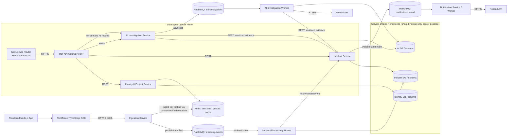
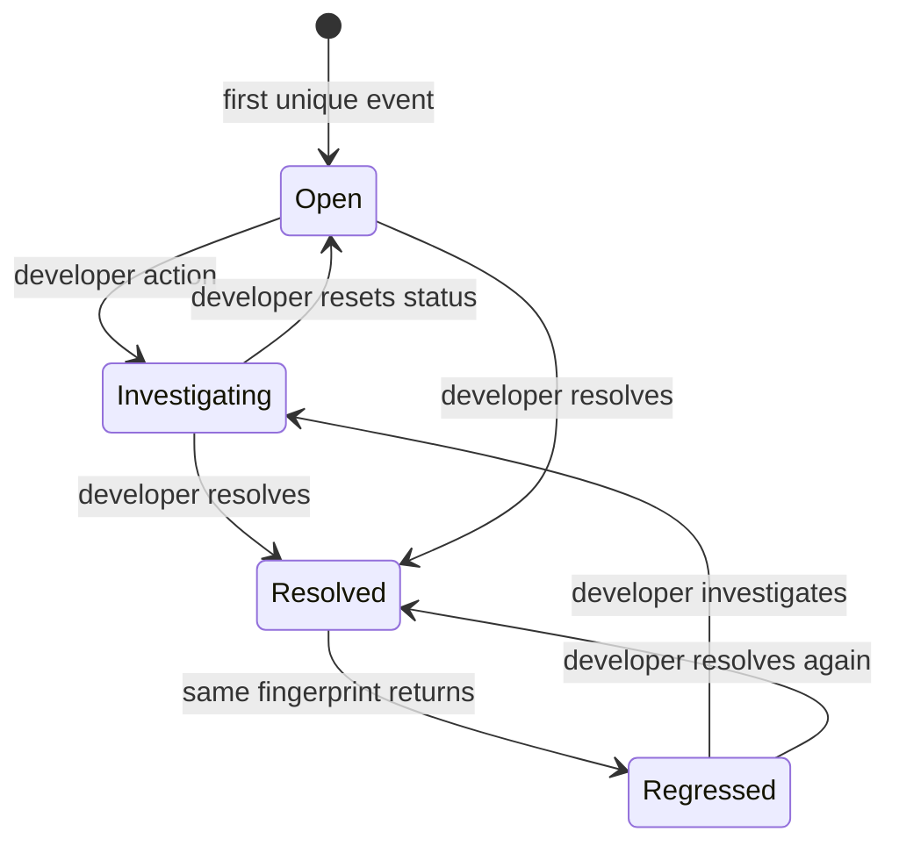

# RootTracer — Technical Requirements Document (TRD)

**Product:** RootTracer — AI Production Reliability & Recovery Platform  
**Document:** Technical Requirements Document, MVP v2.0 — Microservices & Modular Frontend  
**Status:** Approved technical direction; implementation specification  
**Date:** 2026-11-22  
**Audience:** Backend, SDK, frontend, infrastructure, security, and QA engineering  
**Decision basis:** Original 85 approved decisions plus subsequently approved Architecture v2 change: independently deployable backend microservices and a feature-based Next.js frontend (see Appendix A and C).

> **Design principle:** Build a reliable, privacy-first error-monitoring product before implementing automated recovery. An accepted telemetry event is not necessarily processed, and an AI diagnosis is not a verified root cause.

## 1. Purpose and product boundary

RootTracer is a multi-tenant developer SaaS. A developer creates a project, configures a TypeScript monitoring SDK in a Node.js application, sends sanitized error events over HTTPS, and investigates grouped incidents in a Next.js dashboard. Events are ingested durably through RabbitMQ, persisted in PostgreSQL, and optionally investigated through Google Gemini. New, critical, recurring, or regressed incidents may generate dashboard/email alerts.

### 1.1 MVP capabilities (in scope)

1. **Accounts and projects:** email/password registration, verification and reset, Redis-backed sessions, project creation, project-scoped rotating ingestion API keys, and onboarding instructions.
2. **Node.js monitoring SDK:** automatic global error listeners, opt-in Express error middleware, manual `captureException`, event sanitization, batching, configurable sampling, bounded retries and shutdown flush.
3. **Telemetry ingestion:** authenticated, rate-limited HTTPS batch API; schema/size checks; durable queue publish acknowledgement; structured `202 Accepted` response.
4. **Monitoring and incident management:** durable event processing, deduplication, error fingerprinting, grouping, frequency counting, severity, statuses, regression history, search, analytics, 30-day raw-event retention, release/environment filtering, and incident activity timeline.
5. **On-demand AI investigation:** asynchronous Gemini request; sanitized incident evidence; schema-validated root-cause hypotheses, supporting evidence, corrective guidance, limitations, result history, caching, quotas and failure states.
6. **Dashboard and notifications:** approved Concept A light-theme interface, 15-second polling, dashboard alerts and Resend email notifications with cooldown/retries.
7. **Engineering operations:** Docker Compose, SQL migrations, structured logs, health checks, automated tests, GitHub Actions, staging, Helm/Terraform/Kubernetes delivery preparation, backups, and operational documentation.

**MVP scope amendment:** Email notifications were added explicitly in Decision 22 after the initial four-feature focused MVP choice. They are part of the approved MVP.

### 1.2 Explicitly out of MVP

GitHub repository analysis, automated patch/PR generation, business-impact correlation, Smart Recovery execution/approval flows, GitHub deployment event integration, full request tracing/APM, advanced security scanning, team roles/collaboration, Slack/Discord/webhooks, advanced custom analytics, data export, self-hosted product distribution, chatbot-style investigation, and full SRE/error-budget platform. Architecture may reserve interfaces for these features; **no production code paths, privileges, UI promises, or recovery actions** should imply they work in v1.

### 1.3 User roles and tenancy

- **Developer account:** a single owner manages zero or more projects. No organization/team role system in MVP.
- **Project:** isolated unit for ingestion keys, events, incidents, investigations, alerts and settings.
- **Tenant boundary:** `project_id` + verified ownership on every dashboard read/write; SDK API key grants **ingest-only** access to its project.
- **Service actor:** worker activity records an internal actor identifier, not a fictional human user.

## 2. Technology decisions

| Concern | Approved implementation |
|---|---|
| Web | **Next.js App Router + TypeScript**, feature-based modules, Tailwind CSS, shadcn/ui + Radix UI, TanStack Query, Zustand, React Hook Form + Zod, Recharts |
| API | **Independently deployable Node.js + Express + TypeScript microservices**, fronted by a thin gateway/BFF |
| SDK | TypeScript, npm package; Node.js 22/24 LTS; generic Node + Express integration |
| Services | Identity/Project, Ingestion, Incident, AI Investigation, Notification; independently deployed workers owned by relevant services |
| Database | PostgreSQL via `pg`; **service-owned databases/schemas and credentials** on a shared PostgreSQL server initially; bounded `pg.Pool` and parameterized SQL |
| Database changes | Versioned `.sql` migrations with a migration ledger |
| Queue | RabbitMQ durable workload queues, publisher confirms, manual ACKs, retry/DLQ |
| Cache / sessions / limits | Redis |
| AI | Google Gemini API; validated structured JSON |
| Email | Resend API; Mailpit for local email testing |
| Auth | Email/password, Argon2id, Redis server-side sessions, secure cookies |
| Validation / logs | Zod; Pino JSON logs, propagated request IDs |
| Local | Docker Compose; optional local Kubernetes through `kind` or `k3d` |
| Production delivery | Kubernetes + Helm + Terraform; provider **not yet selected** |
| Scaling | HPA for API; KEDA for RabbitMQ-backed workers, bounded replicas |
| CI/CD | GitHub Actions; automated checks, image builds, manual production approval |
| Tests | Vitest, Supertest, Playwright, Docker-based integration tests |

**Architecture pattern (v2, superseding Decision 1):** Five independently deployable backend microservices + a thin Next.js-facing gateway/BFF; every service owns its schema/database and migrations. One monorepo does **not** mean a monolith. Independent services communicate through explicitly versioned REST contracts and RabbitMQ events; no cross-service SQL or shared domain repositories.

## 3. High-level architecture — independent microservices



### 3.1 Service ownership and deployment

| Service | Responsibility | Owns data | Runtime/deployment |
|---|---|---|---|
| **Identity & Project Service** | Registration, email verification, sessions, project ownership, API-key issuance/revocation | `users`, `verification_tokens`, `projects`, `project_api_keys`; Redis sessions | Express HTTP service |
| **Ingestion Service** | SDK key verification, quotas, payload validation, durable RabbitMQ publish, `202` | No direct ownership of incident data; uses **verified cached ingest-key metadata** and/or an internal identity lookup | Express HTTP service |
| **Incident Service** | Fingerprinting, deduplication, event and incident storage, read APIs, severity/status, alert decisions | Daily event partitions, `event_receipts`, incidents, activity, alert configuration/outbox | Express HTTP service **and independently scaled telemetry worker** |
| **AI Investigation Service** | On-demand investigations, Gemini, versions, concurrency/cost control | `ai_investigations` and job state; no direct SQL reads of incident tables | Express HTTP service **and separately scaled AI worker** |
| **Notification Service** | Alert email delivery through Resend, cooldown, retry and delivery records | Notification-delivery state; may use its own schema | Worker deployment, with optional private health/management endpoint |
| **Gateway/BFF** | Route browser requests; session verification/forwarding; CSRF enforcement; request IDs | **No domain database** | Thin HTTP gateway; can be a dedicated Express gateway or carefully scoped Next.js server-side BFF |

**Ownership rules:** Each service may use the same PostgreSQL cluster initially, but uses a separate database or schema, separate database role, and independent versioned SQL migrations. **Do not share tables or access another service's schema via SQL.** Avoid domain logic in the gateway. Shared packages can contain event/API schemas, logging and config—not reusable repositories that bypass service ownership.

**Internal security:** Internal REST calls require service authentication and network-level restrictions. The Identity service is authoritative for project ownership and key validity. Cache entries used by ingestion must have short TTLs and revocation/invalidation behavior. The gateway must not assume that an incoming `project_id` proves authorization.

### 3.2 Trust boundaries and transport

- **Sync HTTPS/REST:** SDK → Ingestion; browser → BFF; BFF → Identity/Incident/AI; AI → Incident (sanitized context); service → Gemini or Resend.
- **Async RabbitMQ:** Ingestion → telemetry; Incident → notification triggers; AI service → investigation queue. Retry queues and DLQs are separate for each responsibility.
- **Private SQL:** Each service → **only its own** PostgreSQL schema/database, with `pg.Pool`, parameterized SQL and service-owned transactions.
- **Redis:** Identity sessions, ingestion quota counters, short-lived validated key lookup caches and narrowly defined rate limits. Prefix/namespace keys by owning service.
- **Privacy:** SDK-side PII redaction and ingestion validation; AI receives sanitized, bounded evidence and does not directly query other services' databases.

### 3.3 End-to-end flows

1. SDK samples, sanitizes, batches, and sends events to **Ingestion Service** over HTTPS.
2. Ingestion validates project ingest credentials and quota; broker-confirmed durable acceptance of the single batch message precedes the structured `202` response.
3. RabbitMQ delivers to the **Incident Service's telemetry worker**. Worker atomically deduplicates, inserts events, updates incident state and commits to the Incident-owned schema before ACK.
4. Incident Service emits alert-trigger events via a transactional outbox/publisher so committed incidents and outgoing notifications cannot silently diverge. Notification Service sends email independently.
5. Next.js dashboard requests project-scoped views through the BFF to Incident Service. Ownership is enforced using identity-backed, authenticated authorization context; poll every ~15 seconds.
6. Developer requests an investigation through the BFF → AI Service. AI Service queues a job, and its worker fetches **sanitized incident evidence through a versioned Incident Service API**, not cross-schema SQL, then calls Gemini.
7. AI Service validates structured results with Zod and persists versioned history to **its own schema**. The dashboard queries the AI API through the BFF.
8. Failures use bounded retries, DLQ, idempotent handlers, observability and graceful shutdown. No automatic production recovery in MVP.

**Implementation trade-off:** This design increases service-to-service latency, independent deployment, testing and operational overhead. It is deliberately chosen to demonstrate distributed-systems engineering; keep deployments to five services plus gateway and only the worker processes that need independent scaling.

## 4. Repository and runtime layout — v2

**Tooling:** pnpm workspaces for dependency/package management; Turborepo for incremental tasks and CI caching. Use one monorepo with **independent service build, Docker image, environment configuration, migrations and Helm deployment**.

```text
roottracer/
├── apps/
│   └── web/                                  # Next.js App Router + TypeScript
│       ├── src/
│       │   ├── app/
│       │   │   ├── (auth)/                   # Login, register, verify, reset
│       │   │   ├── (dashboard)/              # App routes/layouts
│       │   │   ├── layout.tsx
│       │   │   └── providers.tsx
│       │   ├── features/
│       │   │   ├── authentication/
│       │   │   ├── projects/
│       │   │   ├── monitoring/
│       │   │   ├── incidents/
│       │   │   ├── ai-investigation/
│       │   │   ├── notifications/
│       │   │   └── settings/
│       │   ├── components/
│       │   │   ├── ui/                       # shadcn/Radix primitives
│       │   │   └── layout/                   # Navbar/sidebar/shell
│       │   ├── lib/                          # HTTP client, auth helpers, query keys
│       │   ├── hooks/                        # Only cross-feature hooks
│       │   ├── stores/                       # Zustand: UI-only shared state
│       │   └── styles/
│       ├── public/
│       ├── tests/
│       └── Dockerfile
│
├── services/
│   ├── gateway/                              # Thin browser-facing BFF (Express)
│   ├── identity-service/
│   ├── ingestion-service/
│   ├── incident-service/
│   │   ├── src/
│   │   │   ├── api/                          # Versioned incident HTTP routes
│   │   │   ├── domain/                       # Grouping, severity, lifecycle rules
│   │   │   ├── workers/                      # Telemetry processing entry point
│   │   │   ├── repositories/                 # Incident-owned pg queries
│   │   │   └── messaging/                    # Events + outbox
│   │   └── migrations/
│   ├── ai-service/
│   │   ├── src/
│   │   │   ├── api/
│   │   │   ├── workers/
│   │   │   ├── domain/
│   │   │   └── repositories/                 # AI-owned pg queries
│   │   └── migrations/
│   └── notification-service/
│
├── packages/
│   ├── sdk-node/                             # Public TypeScript npm package
│   ├── contracts/                            # Versioned API/event schemas ONLY
│   ├── logger/                               # Pino + correlation IDs
│   ├── config/                               # Zod-validated service config
│   └── ui/                                   # Optional shared web-only UI
│
├── infrastructure/
│   ├── docker/compose.yaml                   # Local services + PG, RabbitMQ, Redis
│   ├── kubernetes/local/                     # kind/k3d testing
│   ├── helm/                                 # Independent charts or releases
│   └── terraform/                            # Cloud provisioning
├── scripts/                                  # Bootstrap + local scheduler + migrations
├── tests/
│   ├── contracts/                            # Sync API & async event compatibility
│   ├── integration/                          # Real Docker services
│   ├── e2e/                                  # Playwright UI/end-to-end flows
│   ├── load/                                 # 100 EPS sustained / 500 EPS bursts
│   └── fixtures/demo-node-app/
├── docs/{architecture,contracts,product,planning,engineering,sdk,runbooks}/
├── .github/workflows/
├── pnpm-workspace.yaml
├── turbo.json
└── package.json
```

**Feature module contract (example):**

```text
apps/web/src/features/incidents/
├── api/                 # Typed API request functions + query keys
├── components/          # IncidentTable, IncidentFilters, IncidentHeader
├── hooks/               # useIncidents, useIncident
├── schemas/             # Client-facing Zod schemas
├── types/               # Types specific to incidents
└── index.ts             # Public feature exports
```

Rules: Keep `app/` focused on route composition and layouts; place product logic under `features/`. Features import shared UI/lib or each other's **public exports**, not deep internal paths. TanStack Query owns server-state caching, Zustand handles lightweight client-only state, React Hook Form + Zod handles forms. Avoid duplicated state across these layers.

### 4.1 Frontend implementation baseline

| Concern | Selected technology | Implementation note |
|---|---|---|
| Framework | **Next.js App Router** | React Server Components for shell/initial data where useful; client components only for interaction |
| Language | TypeScript (strict) | Typed API contracts and null/error handling |
| Styling | Tailwind CSS | RootTracer Concept A light design tokens |
| Components | shadcn/ui + Radix UI | Accessible primitives with reusable app components |
| Server state | TanStack Query | Cache, cursors, conditional **15-second polling** |
| Client-only state | Zustand | Sidebar, filters that truly need global state; keep URL filters shareable |
| Forms | React Hook Form + Zod | Validation consistent with API contracts |
| Charts | Recharts | 24h/7d trends, severity breakdown; label accessible equivalents |
| Tests | Vitest, React Testing Library, Playwright | Unit/component/E2E |
| Monorepo | pnpm + Turborepo | Independent service builds and checks |

### 4.2 Environment and integration

- **Local:** Docker Compose runs PostgreSQL, Redis, RabbitMQ, Mailpit and all backend services; Next.js may run on host for HMR or in a dev container. Service-to-service ports are private; only ingress/BFF and local tools expose selected host ports.
- **Configuration:** public Next.js environment variables contain only non-secret values. BFF and backend own session credentials, Gemini/Resend keys and ingest key verification. Use secure cookie settings in production.
- **Deployment:** independent Docker images and Kubernetes deployments for frontend, gateway and each service; incident and AI workers may scale via KEDA separately from HTTP APIs. Helm charts/values and Terraform must not embed secrets.
- **Session handling:** Identity Service is source of truth for Redis sessions; gateway validates or introspects them using an explicit internal contract. Frontend does not store auth tokens in localStorage.
- **Frontend boundary:** dashboard calls the gateway/BFF, never PostgreSQL, RabbitMQ or Gemini directly.

## 5. SDK technical specification

### 5.1 Supported runtime and APIs

- Official runtime matrix: Node.js 22 and 24 LTS; smoke tests on both supported versions.
- Generic capture: `captureException(error, context?)`, `captureMessage(message, level?)` (optional convenience).
- Automatic global capture: `uncaughtException` / `unhandledRejection` observers, installed only when enabled. **Do not swallow, suppress, replace, or hijack Node's failure semantics.** Never change app process exit behavior.
- Express: opt-in error middleware that captures and always forwards to `next(err)`; it must be positioned according to Express error-handler conventions.
- Lifecycle: `init(...)`, `flush({ timeoutMs? })`, and `shutdown({ timeoutMs? })`; default shutdown flush limit **2,000 ms**; do not register intrusive process shutdown handlers.
- Distribution: public npm package (proposed name `@roottracer/node` pending namespace verification), TypeScript declarations, ESM + CJS build, README, changelog, SemVer.

### 5.2 Configuration contract

```ts
interface RootTracerOptions {
  apiKey: string;                // ingest-only; server-side environment variable
  endpoint: string;              // HTTPS in production
  environment: 'development' | 'staging' | 'production' | string;
  release?: string;              // application version / commit SHA
  sampleRate?: number;           // 0..1; default 1
  enabled?: boolean;             // default true
  batchSize?: number;            // configured hard cap
  flushIntervalMs?: number;
  maxBufferEvents?: number;      // bounded in-memory memory use
  requestTimeoutMs?: number;
  maxRetries?: number;           // bounded, exponential backoff + jitter
  captureGlobalErrors?: boolean;
  scrubFields?: string[];        // additional deny rules
}
```

### 5.3 Safe collection policy

- Default collection: error type, sanitized message and stack, occurrence timestamp, environment, release, SDK/schema versions, selected safe request metadata (method, normalized route/host if configured), explicit allowlisted custom tags.
- **Never collect by default:** raw HTTP request/response bodies, authentication headers, cookies, passwords, bearer tokens, session IDs, personal identifiers or unrestricted arbitrary object dumps.
- Redact on the SDK **and** again at ingestion; reject events that exceed size limits; cap stack length, tag count and string sizes.
- Assign stable `event_id` (UUID) **before retries** and never regenerate it for retransmissions. Event `occurred_at` must be bounded against unreasonable timestamps.
- Non-blocking in the application error path: no synchronous network/disk I/O. Buffer full → record internal dropped count if safe, discard per configured policy; no exception propagation to host code.
- Sampling may discard events. Dashboard counts represent **events received**, not original application error totals.
- In-memory buffering has no crash durability guarantee; document this limitation.

### 5.4 Sample SDK integration

```ts
import { initRootTracer, rootTracerExpressErrorHandler } from '@roottracer/node';

const tracer = initRootTracer({
  apiKey: process.env.ROOTTRACER_API_KEY!,
  endpoint: process.env.ROOTTRACER_ENDPOINT!,
  environment: process.env.NODE_ENV ?? 'development',
  release: process.env.APP_RELEASE,
  captureGlobalErrors: true,
});

// Register after application routes, before final error responders.
app.use(rootTracerExpressErrorHandler(tracer));

// In an existing graceful shutdown routine:
await tracer.shutdown({ timeoutMs: 2000 });
```

*Illustrative API names; the final SDK public signatures must be locked in `packages/contracts` and validated by integration tests.*

## 6. Public HTTP API and contracts

### 6.1 API conventions

- Browser-facing gateway prefix: `/api/v1`, routing to service-owned versioned HTTP APIs. Public ingest prefix: `/ingest/v1` is served by the **independent Ingestion Service** (separate deployment and authentication middleware).
- JSON over HTTPS, content type validation, Zod schemas, maximum body size, request IDs, consistent error envelopes.
- Browser authentication: HttpOnly, Secure, SameSite cookies; Redis-backed session ID. CSRF defense on state-changing browser routes and secure CORS policy.
- SDK auth: `Authorization: Bearer <project_ingest_key>` (or dedicated `X-RootTracer-Key`; choose **one** in final OpenAPI). Never place SDK keys in query parameters.
- All browser APIs must check user → project ownership using validated identity context; ownership is enforced at service boundaries, not only the gateway. Project IDs in URLs never authorize access by themselves.

### 6.2 Endpoint inventory (MVP)

| Method | Path | Authentication | Function |
|---|---|---|---|
| POST | `/api/v1/auth/register` | anonymous | Create unverified account |
| POST | `/api/v1/auth/verify-email` | single-use token | Verify email |
| POST | `/api/v1/auth/login` | anonymous | Start session |
| POST | `/api/v1/auth/logout` | session + CSRF | Revoke session |
| POST | `/api/v1/auth/password/forgot` | anonymous | Request password reset |
| POST | `/api/v1/auth/password/reset` | single-use token | Reset password; revoke active sessions as policy |
| GET | `/api/v1/me` | session | Current account |
| GET/POST | `/api/v1/projects` | session | List/create projects |
| GET/PATCH/DELETE | `/api/v1/projects/:projectId` | owner session | Details/update/soft-delete |
| POST | `/api/v1/projects/:projectId/keys` | owner session + CSRF | Create ingest API key (secret shown once) |
| GET | `/api/v1/projects/:projectId/keys` | owner session | List metadata, never raw key |
| DELETE | `/api/v1/projects/:projectId/keys/:keyId` | owner session + CSRF | Revoke key |
| POST | `/ingest/v1/events/batch` | project ingest key | Validate and durably enqueue atomic batch |
| GET | `/api/v1/projects/:projectId/dashboard` | owner session | KPIs, trends, top incidents |
| GET | `/api/v1/projects/:projectId/incidents` | owner session | Search, filter and cursor pagination |
| GET | `/api/v1/projects/:projectId/incidents/:incidentId` | owner session | Detail, events, history |
| PATCH | `/api/v1/projects/:projectId/incidents/:incidentId` | owner session + CSRF | Update status/severity |
| POST | `/api/v1/projects/:projectId/incidents/:incidentId/investigations` | owner session + CSRF | Request on-demand Gemini analysis |
| GET | `/api/v1/projects/:projectId/incidents/:incidentId/investigations` | owner session | Get versioned investigation history |
| GET | `/api/v1/projects/:projectId/investigations/:investigationId` | owner session | Get job/result state |
| GET/PATCH | `/api/v1/projects/:projectId/alert-settings` | owner session | Read/update baseline alert preferences |
| GET | `/health/live` | internal/probed | Process liveness |
| GET | `/health/ready` | internal/probed | Dependency readiness |

**Routes are proposed concrete v1 contracts**, not already implemented; finalize them in OpenAPI before SDK/client coding. Avoid unnecessary publicly exposed internal worker or scheduler endpoints.

### 6.3 Event batch request and response

```json
{
  "schema_version": 1,
  "sdk_version": "1.0.0",
  "events": [{
    "event_id": "08b4a5ea-40d6-4a76-97bc-63723ec46528",
    "occurred_at": "2026-11-22T16:00:00.000Z",
    "type": "TypeError",
    "message": "Cannot read properties of undefined",
    "stack_trace": "TypeError: ...\\n  at ...",
    "environment": "production",
    "release": "1.2.0",
    "level": "error",
    "context": {"http_method": "POST", "route": "/api/orders"}
  }]
}
```

```http
HTTP/1.1 202 Accepted
Content-Type: application/json
```

```json
{
  "request_id": "req_01H...",
  "accepted_count": 1,
  "server_timestamp": "2026-11-22T16:00:01.000Z"
}
```

**Acceptance rule:** A valid batch is accepted atomically as a single persistent broker message. If publisher confirmation is missing or negative, respond with retryable `503` (unless an exact outcome can be proven). Because a connection may fail **after** broker acceptance but **before** HTTP response, SDK retry may create a duplicate queue delivery; event IDs and database idempotency make it safe. A `202` must never be returned before broker confirmation.

### 6.4 Standard error envelope

```json
{
  "error": {
    "code": "RATE_LIMITED",
    "message": "Request limit exceeded",
    "request_id": "req_01H...",
    "retryable": true
  }
}
```

Use `400` invalid input, `401` invalid credentials, `403` unauthorized project, `404` nonvisible resource, `409` conflict, `413` oversized payload, `422` validation failure where appropriate, `429` rate limit, and `503` unavailable/overloaded. Add `Retry-After` when useful. Do not expose SQL errors, exception internals, secrets or tenant existence in responses.

## 7. RabbitMQ topology, consistency and retries

### 7.1 Queues/exchanges

| Workload | Exchange / routing concept | Durable queue | Worker | DLQ |
|---|---|---|---|---|
| Telemetry | `telemetry` exchange; `events.batch` routing | `telemetry.events` | `event-worker` | `telemetry.events.dlq` |
| AI requests | `ai` exchange; `investigation.requested` | `ai.investigations` | `ai-worker` | `ai.investigations.dlq` |
| Email | `notifications` exchange; `email.send` | `notifications.email` | `notification-worker` | `notifications.email.dlq` |

Retry queues may be introduced per workload (TTL + dead-letter routing or broker delayed-message strategy), with **bounded attempts** and jittered delay. Use `delivery_mode: 2` persistent messages, durable exchange/queue declarations, broker publisher confirms, manual consumer ACK and finite consumer prefetch.

### 7.2 Common message envelope

```ts
interface QueueEnvelope<T> {
  message_id: string;      // stable across retries
  message_type: string;
  schema_version: number;
  created_at: string;
  correlation_id: string;
  attempt: number;
  payload: T;
}
```

- Telemetry envelope contains **a validated event batch** with batch/request identity. Preserve individual `event_id`s.
- `ai.investigations` references immutable `investigation_id`, `project_id` and `incident_id`; worker fetches evidence from DB, rather than shipping full sensitive context in the queue.
- `notifications.email` references notification ID and safe template data; avoid raw stack trace in email.
- Poison/unrecoverable schema messages go to DLQ, with alerting and manual inspection/redrive runbook.

### 7.3 Transaction and ACK semantics

For each incoming event, do all within one PostgreSQL transaction:

1. Attempt to claim `(project_id, event_id)` in an **unpartitioned event receipt/idempotency table** using a unique constraint.
2. If already claimed, treat as duplicate: do not increment incident count; commit no-op.
3. Compute normalized fingerprint from project, environment, error type and stable stack frames; find/create incident under appropriate uniqueness/locking constraints.
4. Insert raw event in the appropriate daily partition and atomically increment incident count / `last_seen` / severity rules.
5. Insert incident activity / alert-outbox entry as needed; commit.

After the **whole batch** has been durably committed, ACK the queue message. On transient failure, roll back the current transaction and retry the message; already committed event IDs prevent overcounting. Keep a retention window for idempotency receipts at least as long as maximum supported retry/redelivery age, **including late messages**, and explicitly set a maximum event age to avoid reaccepting old retransmissions after receipts expire.

**Cross-system consistency:** Database commit + RabbitMQ ACK are not a distributed transaction. Idempotency handles telemetry redelivery; **transactional outbox** (DB row inserted with incident update, then dispatched to RabbitMQ) is recommended for reliable alert publication so a crash between DB commit and queue publish does not silently lose alerts.

### 7.4 Backpressure

- Enforce per-project ingestion quotas and global service rate limits with Redis-backed controls.
- Bound batch count, encoded size, queue lengths and worker prefetch; monitor backlog and broker disk/memory pressure.
- On overload, return `429` or `503`, with retry guidance; SDK backoff must be bounded and must never block host request handling.
- Never blindly requeue the same poison message in a tight loop. Retrying a batch can repeat successful event inserts; idempotency is mandatory.

## 8. PostgreSQL data model

**Architecture v2 ownership note:** The tables below form a **logical cross-service inventory**, not one shared SQL namespace. Identity owns user/project/key tables; Incident owns events, receipts, grouping, alerts/activity; AI owns investigation records; Notification owns email delivery records. Every service has its own migrations, role and database/schema. Foreign keys **across services** are replaced with immutable IDs plus application-level validation/contracts. A project's authoritative existence/deletion lives in Identity; other services react to versioned lifecycle events and perform idempotent cleanup. Redis sessions remain owned by Identity.

### 8.1 Tables (minimum proposed schema)

| Table | Key fields | Notes |
|---|---|---|
| `users` | `id`, `email UNIQUE`, `password_hash`, `email_verified_at`, timestamps | Argon2id; normalized email |
| `verification_tokens` | `id`, `user_id`, `token_hash`, `purpose`, `expires_at`, `used_at` | Single-use, short-lived |
| `projects` | `id`, `owner_user_id`, `name`, `slug`, `deleted_at`, `purge_after` | Project ownership, soft delete |
| `project_api_keys` | `id`, `project_id`, `key_prefix`, `key_hash`, `created_at`, `revoked_at`, `last_used_at` | Show secret once; rotation overlap |
| `events` | `project_id`, `event_id`, `incident_id`, `occurred_at`, `received_at`, `environment`, `release`, `severity`, `error_type`, `message`, `stack_trace`, `fingerprint`, `context JSONB` | **Daily range partitioning**; raw TTL 30 days |
| `event_receipts` | `project_id`, `event_id`, `accepted_at`, `event_occurred_at` | Unpartitioned unique pair for global dedupe across daily partitions; lifecycle managed |
| `incidents` | `id`, `project_id`, `environment`, `fingerprint`, `status`, `severity`, `occurrence_count`, `first_seen`, `last_seen`, `first_seen_release`, `resolved_at`, `regression_count` | Unique `(project_id, environment, fingerprint)` for current grouping strategy |
| `incident_activity` | `id`, `project_id`, `incident_id`, `actor_type`, `actor_id`, `action`, `old_value JSONB`, `new_value JSONB`, `created_at` | Timeline / audit |
| `ai_investigations` | `id`, `project_id`, `incident_id`, `status`, `evidence_hash`, `prompt_version`, `model_id`, `result JSONB`, `failure_code`, `created_at`, `completed_at` | Immutable/versioned results |
| `alert_rules` | `id`, `project_id`, `rule_type`, `severity`, `enabled`, `threshold`, `cooldown_seconds` | Initial predefined rules; no complex rule builder |
| `notifications` | `id`, `project_id`, `incident_id`, `channel`, `status`, `dedupe_key`, `last_attempt_at`, `sent_at` | Cooldown/dedupe; email delivery history |
| `outbox_messages` | `id`, `event_type`, `payload JSONB`, `created_at`, `published_at` | DB→broker reliability for alert jobs |
| `schema_migrations` | `version`, `checksum`, `applied_at` | Single runner, drift detection |

Redis contains server-side session records, rate-limit counters and ephemeral hot state; **do not use Redis as the sole source of incident truth**. Password reset/verification token hashes belong in PostgreSQL (or equally durable approved store), not email bodies or application logs.

### 8.2 Index and query strategy

- Incident indexes based on patterns: `(project_id, environment, status, last_seen DESC, id DESC)` and `(project_id, severity, last_seen DESC, id DESC)`; add only after `EXPLAIN ANALYZE` validation.
- Event partitions: local indexes `(project_id, occurred_at DESC)` and `(project_id, incident_id, occurred_at DESC)`; add `(project_id, event_id)` where useful for local queries, but **not** as an assumed globally unique key.
- Full-text search: generated `tsvector` or expression GIN index on incident `message` and `error_type` (depending on chosen schema); always combine with project ownership filtering.
- Cursor pagination uses stable ordering `(last_seen DESC, id DESC)` with an encoded cursor, rather than unbounded `OFFSET`.
- Chart queries should operate on bounded time windows and summaries when necessary; do not scan 259M raw rows per dashboard refresh.

### 8.3 Partition maintenance and retention

- `events` partitioned by `occurred_at` or preferably validated `received_at` (pick the canonical partition key and document it before migrations). If partitioning by client time, enforce strict time skew policy and have a default/reject path.
- Create future daily partitions ahead of time. Detach/drop expired partitions by scheduled maintenance after 30-day retention. Expiration is based on the **declared canonical retention timestamp**, not arbitrary user input.
- Incident summaries/aggregates outlive raw events; define a separate, finite project lifecycle and delete them on project purge.
- `event_receipts` cleanup must respect retry horizons and dedup safety; it does not automatically inherit identical 30-day partition cleanup.
- Estimate storage at **100 events/sec × 86,400 = 8.64 million/day; about 259.2 million events in 30 days** at constant load. That is a design target, **not proven capacity**. Partitioning alone does not guarantee acceptable storage cost or latency; load test, estimate byte size/index overhead, provision capacity, and consider retention adjustments if needed.
- At project purge, delete related records across partitions in throttled batches; dropping a shared daily partition would also delete other tenants' data and is forbidden.

### 8.4 Migrations and connection limits

- Versioned forward SQL migrations, checksum ledger, reviewable PRs and migration tests against empty/fresh and upgraded databases.
- Use **service-owned** `pg.Pool` with explicit max connections per API/worker replica, connection/statement timeouts, error handling and graceful close.
- Maximum replicas × per-replica connection pool sizes + administrative reserve must stay below managed PostgreSQL connection limit. Evaluate PgBouncer later if needed.
- Schema changes should be backward-compatible across rolling updates (expand → migrate/backfill → contract). Helm rollback does **not** automatically reverse database migrations.

## 9. Incident lifecycle, severity and alerting

### 9.1 Fingerprinting

Fingerprint is a deterministic hash of `(project_id, environment, normalized error type, normalized significant stack frames)`. Normalize unstable tokens (IDs, offsets, paths where appropriate) while preserving meaningful location information. Store algorithm version; changing grouping rules requires a migration/reconciliation strategy. Fingerprint is **not** event uniqueness; event ID is.

### 9.2 Incident states



- The same fingerprint arriving in the same project/environment after resolution marks the **existing incident** `Regressed` and records a regression activity event.
- Severity: deterministic rules from error type, environment, frequency and configured thresholds; developer can override. Severity does **not** magically infer business impact.
- Track `first_seen`, `last_seen`, occurrence count, resolution time, regression count, release history and status/override actor.

### 9.3 Alerts

- MVP alert types: new incident, critical incident, regression, frequency threshold. Rules start with predefined settings, not a generalized rule-builder UI.
- Event workers evaluate alert conditions and append transactional outbox records; notification dispatcher publishes emails to RabbitMQ.
- Email worker renders safe messages (incident summary + authenticated dashboard deep link), calls Resend, records outcome, retries transient failures and DLQs exhausted jobs.
- Cooldown/dedupe key: include project, incident, rule and configured cooldown window. Rate-limit notification fan-out and avoid exposing raw sensitive stack trace in messages.
- Local testing: Mailpit. Production email requires verified sender domain, DKIM/SPF configuration and provider quota handling.

## 10. Gemini AI investigation

### 10.1 Trigger and state machine

Only a verified project owner can click **Investigate with AI** on an incident. The API checks existing equivalent completed/active investigations using an evidence hash and per-project limits; if needed, creates a new job and queues it.

`Pending → Processing → Completed | Failed` (and optional `Cancelled` in future). Store timestamps, model identifier, prompt version, evidence digest, failure category, retry count and the structured result.

### 10.2 Input and output contracts

Input is bounded **sanitized** incident evidence: type/message, selected stack frames, relevant safe HTTP route metadata, environment, release, occurrence history, first/last seen and severity. Do not send arbitrary raw payloads, secrets, full request bodies or source repository content in MVP.

Expected response schema (illustrative):

```ts
type InvestigationResult = {
  summary: string;
  probable_causes: Array<{
    cause: string;
    evidence: string[];
    reasoning: string;
  }>;
  suggested_actions: Array<{
    action: string;
    rationale: string;
    risk?: string;
  }>;
  confidence_assessment: 'low' | 'medium' | 'high';
  unknowns_and_limitations: string[];
};
```

- Validate schema with Zod, reject unsuitable responses, sanitize presentation and store an immutable versioned record.
- AI confidence is a model-provided qualitative estimate, **not a calibrated probability**.
- Suggestions are advisory; **AI cannot execute recovery, change production code, open GitHub PRs or access developer credentials** in MVP.

### 10.3 Reliability and cost controls

- Bounded worker concurrency, queue prefetch, per-project admission quotas and a global provider concurrency cap.
- Cache/reuse results for unchanged evidence; permit explicit re-investigation when evidence changes.
- Request timeout and bounded exponential retries for retryable rate-limit/5xx/network failures. Reject permanent invalid schema/input quickly; persist an understandable failure status.
- A failing Gemini dependency must not affect event capture, ingestion, incident queries or non-AI alerts.
- Version prompt templates in source control and log metadata (not raw sensitive prompts) for debugging.

## 11. Authentication, authorization and security

### 11.1 Browser auth

- Argon2id password hashes with appropriate calibrated parameters; never store or log plaintext passwords.
- Registration requires verified email before sensitive project operations; verification and password reset links are random, hashed in storage, single-use and expiring.
- Redis stores server-side sessions with TTL and a strongly random session ID; cookie is `HttpOnly`, `Secure` (production), `SameSite` appropriately configured and narrowly scoped.
- Rotate session ID on login/privilege changes; invalidate on logout, password reset per defined policy, and account deletion.
- Enforce CSRF protection on state-changing browser requests; CORS is **not** CSRF prevention.
- Rate-limit login, password reset, verification attempts and public ingestion. Avoid account enumeration in reset responses.

### 11.2 Project ingestion keys

- Generate cryptographically random key with public prefix and secret portion. Store **hash only**; display full secret once, use constant-time comparison where applicable.
- Allow multiple concurrent keys and overlapping rotation. Support immediate emergency revocation; revoked keys must fail authentication promptly even with caches.
- Ingest-only scope; **never** authorize dashboard, account management, AI requests or recovery operations.
- Track metadata and last-used timestamp, without storing the raw key. Keys must be server-side, never embedded in browser JavaScript.

### 11.3 Required MVP security baseline

**Decision 45 selected “Basic API Security,” but cannot override previously approved safety requirements** (session CSRF, project isolation, secure cookie settings, API key hashing, request/rate limiting and privacy scrubbing). These are required controls, not optional enterprise extensions.

- HTTPS/TLS; strict input validation; request size caps; security headers; narrow CORS; database parameterization.
- Project-level authorization in central route/domain policy; test cross-project reads, writes and ID enumeration.
- Redaction SDK-side and server-side; avoid sensitive values in logs, Gemini prompts, queue bodies, email and front-end telemetry.
- Secret sources: untracked local `.env`, managed cloud secret manager in production, startup validation and access restrictions.
- No advanced WAF, enterprise SIEM, threat intelligence or dedicated vulnerability scanning in MVP.
- Security-sensitive account/project/key changes should generate limited audit records; avoid creating a generalized audit reporting platform.

## 12. Frontend experience and screen requirements

**Frontend is a single modular Next.js application, not micro-frontends.** Its exact feature folders and supporting libraries are specified in §4. Each page composes feature-level components and accesses only typed gateway APIs.

Use the approved **RootTracer Concept A — Clear Overview** light visual system. The original 17-page design covers future modules; **only implement MVP screens/states** and label unreleased features appropriately (hide or mark Coming Later, never show fake functional buttons).

| Screen / flow | MVP functional requirements |
|---|---|
| Landing + authentication | Signup, login, verify email, forgot/reset password |
| Project onboarding | Create project, generate/revoke keys, copy SDK setup example, connection verification |
| Monitoring dashboard | Error count, open/resolved counts, severity distribution, 24h/7d trend, recurring incidents, environment switch |
| Error Explorer | Project-scoped search, severity/status/environment/date filters and cursor pagination |
| Incident detail | Sanitized stack, release/environment, occurrence timeline, status/severity action, activity history |
| AI Investigator | On-demand action, job state, evidence, hypotheses, suggested fix, limitations, versioned history |
| Notification settings | Enable/disable predefined email alerts, cooldown and delivery preferences |
| Project settings | Project details, API keys, rotation, soft-delete/restore where allowed |

- Use TanStack Query for network cache, pagination and 15-second incident/dashboard polling; suspend in background/hidden tabs where appropriate.
- Show loading, empty, error, unauthorized and rate-limited states; display stale-data/last-updated indicator on monitoring views.
- Use accessible component roles, keyboard navigation, readable contrast and responsive layouts. Display timestamps with timezone clearly.
- Store filters in URL/query state where appropriate; never show one project's cached data when changing projects.

## 13. Operational deployment and CI/CD

**Architecture v2 deployment rule:** A Git push may build multiple artifacts in one monorepo pipeline, but each microservice has an independent Docker image, rollout, health check, secrets, resource sizing, and rollback path. DB migrations execute only for the owning service. Add consumer-driven contracts, propagation of correlation IDs and inter-service authentication to the release gates.

### 13.1 Environments

- **Development:** Docker Compose runs Express API, Next.js, PostgreSQL, RabbitMQ management UI, Redis, workers, Mailpit, scheduler and demo app.
- **Local Kubernetes validation:** `kind`/`k3d`, Helm chart smoke tests and relevant scaling/probe behavior; not required before writing the first SDK feature.
- **Staging:** production-like config boundaries, isolated secrets and data; run database migrations and E2E smoke tests before production.
- **Production:** managed cloud containers/Kubernetes, managed PostgreSQL with PITR and secret manager. **Cloud provider not yet chosen.** Terraform provisions provider-specific infrastructure when selected. Keep Kubernetes optional until public deployment phase; no invented vendor services in initial TRD.

### 13.2 Kubernetes design

- Independently deploy API, web, telemetry workers, AI workers and notification workers with resource requests/limits and separate service accounts where possible.
- API HPA responds to validated CPU/resource metrics; KEDA scales worker pods using RabbitMQ queue length/age where supported. Enforce sensible min/max replicas and database connection budget.
- Readiness/liveness/startup probes; graceful SIGTERM drain on workers; stop consuming, finish/ACK in-flight messages or safely allow redelivery before termination deadline.
- Rolling deployments; Helm upgrade with wait/timeout and rollback procedure. Schema migrations run once as controlled job, not independently in every replica.
- Kubernetes CronJobs manage future partition creation, expired partition cleanup, soft-delete purges, receipt cleanup and outbox maintenance; `concurrencyPolicy: Forbid` and idempotent handlers.

### 13.3 CI/CD

Pull request workflow: lint → TypeScript typecheck → unit tests → contract checks → integration tests → frontend build → SDK package build. Main branch: build/tag immutable Docker images and publish to configured registry after checks. Staging deployment and smoke checks precede **manually approved production** Helm rollout. Record build commit, migration version and image digests for rollback/debugging.

### 13.4 Backups and recovery

- Managed PostgreSQL automated backups plus WAL-based point-in-time recovery; regular automated/assisted restore drills.
- **Targets (not guaranteed):** RPO ≤ 15 minutes, RTO ≤ 2 hours; validate with provider capabilities and actual drills.
- Backups have provider-specific retention and restore procedures; project deletion from active data may persist in immutable backups until their expiry. Document transparently.
- Do not assume restoring PostgreSQL also restores RabbitMQ messages or Redis sessions. Define broker and Redis recovery expectations separately.

### 13.5 RootTracer's own health

Decision 50 selected **basic health monitoring**, not a full SLO/error-budget program. Required: Pino logs, request/correlation IDs, API readiness/liveness, worker heartbeat/status, queue backlog inspection, simple uptime checks and operator runbooks. Do not promise availability SLAs. Capacity targets remain measurable load-test goals from Decision 20.

## 14. Non-functional requirements and test gates

| Area | Requirement / test gate |
|---|---|
| Sustained load | Demonstrate **100 events/sec**, with **500 events/sec brief bursts** in a specified reproducible test environment; record p50/p95 latency, processing lag, broker backlog and database footprint |
| Acceptance semantics | Ingestion returns `202` only after durable broker publisher confirmation; other outcomes return explicit errors |
| Duplicate safety | Re-send same event ID across SDK/HTTP and broker retries; PostgreSQL stores/counts event only once |
| Isolation | Account A cannot list/read/mutate account B's projects, keys, events, incidents or AI results |
| SDK host safety | SDK network errors, slow server, full buffer and shutdown must not throw into host request handlers or block network operations synchronously |
| Retention | Raw events expire after 30 days via documented partition schedule; incident summary remains as specified |
| AI independence | Gemini outage causes failed/queued investigations but does not break monitoring or email handling |
| AI quality boundary | UI shows evidence and unknowns; no claims of certain diagnosis and no production fix execution |
| Alert reliability | Duplicate event does not produce duplicate alert storm; transient email failure retried and visible in status |
| Restore | Execute and document PITR restore drill; measure achieved RPO/RTO instead of asserting target met |
| Auth | Verification, reset token replay, session expiration, CSRF, revoked key and cross-project access tests pass |
| Delivery | Staging smoke tests pass, controlled migration works across rolling deploy, documented manual production approval |

**Capacity caveat:** 100 events/sec sustained for 30 days produces roughly 259 million raw events. Production readiness depends on measured average event size, index and WAL overhead, database compute/storage costs, retention enforcement and queue backlog thresholds. Treat the target as an engineering qualification test; don't promise unlimited free-tier capacity.

### 14.1 Automated test plan

- **Unit (Vitest):** scrubbing, sampling, fingerprints, severity rules, incident state transitions, SDK buffer/retry logic, AI output validation.
- **API integration (Supertest + PostgreSQL + Redis):** auth/session/CSRF, project ownership, key lifecycle, ingest validation, REST error formats, cursor pagination.
- **Messaging integration (RabbitMQ + PostgreSQL):** publisher confirm, broker disruption, worker crash after commit before ACK, duplicate redelivery, poison message DLQ, transaction rollback.
- **AI integration:** Gemini mocked response, rate limit, timeout, malformed JSON, duplicate job and evidence-hash reuse; optional gated live smoke test using provider credentials.
- **Frontend E2E (Playwright):** user signup/verification (Mailpit), login, project create, SDK onboarding, incident list/details, AI request/results and alerts.
- **Load/failure:** synthetic 100/500 EPS traffic, batch-size variations, 15-second polling overhead, DB connection exhaustion safety and RabbitMQ backlog recovery.
- **Real app test:** SDK in an existing Node.js app; explicitly consent to telemetry and use synthetic non-sensitive errors in test/staging.

## 15. Phased implementation plan

**Architecture v2 execution order:** Shared contracts/tooling → Identity/Project Service → Ingestion Service → Incident API + telemetry worker → Next.js dashboard feature modules → AI Service + worker → Notification Service → hardened deployment. Each new service needs health checks, Dockerfile, ownership tests, independently executable migrations, and API/event contract tests.

| Phase | Deliverable | Exit criterion |
|---|---|---|
| P0 — Contracts and foundation | Monorepo, Docker Compose, `pg` SQL migration runner, Redis sessions, auth/project models, OpenAPI draft, Zod event schema | Local stack boots; signup + project + key flows function |
| P1 — SDK and ingestion | npm SDK alpha, Express middleware, sanitized batches, key auth, `202` publish-confirm API, RabbitMQ telemetry worker | Synthetic error reaches PostgreSQL from SDK |
| P2 — Incident engine | Idempotent event storage, partitioning, grouping, severity, lifecycle, search, dashboard API | Repeat event counts once; real incident group appears |
| P3 — Frontend | Concept A dashboard, onboarding, filters, incident detail, status changes and polling | Developer connects app and inspects incidents end-to-end |
| P4 — Gemini | AI queue/worker, sanitized evidence, Zod output, stored history, quotas/cache, UI result | Evidence-based on-demand investigation completes; failures visible |
| P5 — Notifications and hardening | Resend/Mailpit alerts, cooldown, DLQ/runbooks, verification/reset, end-to-end tests, retention, load test | Approved MVP acceptance suite passes in staging |
| P6 — Deployment | Local kind/k3d + Helm, Terraform for chosen cloud, CI/CD, staging/prod, restore drill | Manual-approved production release with documented operations |

Development is **vertical-slice first**; avoid implementing full Kubernetes/enterprise operations before the first end-to-end error event works.

## 16. Open implementation parameters (not additional product-scope decisions)

The 85 decisions approve **approaches**, not arbitrary numeric defaults. Engineering must record the following in config/OpenAPI during P0–P1 and test them before launch:

- Actual SDK buffer cap, batch maximum events/bytes, flush interval, network timeout, retry count/backoff/jitter and event maximum age.
- Exact per-key ingress quota and burst capacity; queue max length and disk thresholds; retry TTL/DLQ settings; worker prefetch and concurrency.
- Auth session lifetime, idle timeout, reset/verification token TTL, password parameters and lockout/rate-limit thresholds.
- Gemini provider model identifier, prompt token budget, concurrency/per-project quotas, cost guardrail and exact investigation timeout.
- Daily partition key choice, skew tolerance, idempotency receipt retention, backup retention, incident-summary retention and audit retention.
- Severity thresholds, alert cooldown values, email sender domain and notification quotas.
- Managed cloud vendor/region, production replica bounds, PostgreSQL instance class, storage estimates, rollout budget and hosting spend ceiling.

**These are implementation-time parameters**, not gaps in the approved MVP functional scope. Document values as change-controlled configuration rather than inventing unsupported guarantees.

## 17. MVP definition of done

RootTracer MVP is ready for an initial controlled launch when all are true:

1. A developer can register, verify email, sign in, reset password, create a project, and issue/revoke an ingestion key.
2. The public TypeScript Node.js SDK captures automatic/manual errors and Express errors without breaking the host app; it redacts and batches events.
3. The ingestion edge validates keys, payload size and rate limits and only issues `202` after RabbitMQ durable publisher confirmation.
4. Workers safely retry, deduplicate event IDs and group by deterministic project/environment fingerprint; PostgreSQL incident counts remain correct under redelivery.
5. Dashboard provides filters, search, incident details, activity timeline, severity/status changes and trends with automatic polling.
6. Gemini investigations run only on explicit developer request, return validated evidence-based structured results and maintain history without privileged recovery actions.
7. Email notifications work through independent worker/Resend with cooldown, retries and DLQ; failure does not block monitoring.
8. Privacy, multi-tenant isolation, session security, key rotation, 30-day event retention and scheduled purge behavior pass automated tests.
9. Unit, integration, E2E and defined load/failure tests pass; results and limitations are documented, including the 100/500 EPS target.
10. Deployment, rollback and PITR restore procedures are documented and exercised in staging; production deployment is approval-gated.

## Appendix A — Decision register (1–85)

The register preserves the **actual approved choices**, including intentional departures from the recommended options. Decisions 68–85 were approved as a group.

| # | Approved choice | Binding outcome |
|---:|---|---|
| 1 | B → **superseded by Architecture v2** | Originally modular monolith + workers; subsequently replaced by **independent Express microservices** at user request |
| 2 | C | PostgreSQL `pg` driver; Docker-hosted local DB |
| 3 | B | Redis server-side browser sessions |
| 4 | B | Automatic + manual Node/Express exception capture |
| 5 | B | RabbitMQ reliable delivery, retries, DLQ, idempotency |
| 6 | B | Deterministic error fingerprint grouping |
| 7 | B | 30-day raw event retention; longer-lived incident summaries |
| 8 | B | Developer-triggered on-demand AI investigation |
| 9 | B | Rotatable, hashed project ingest API keys |
| 10 | A | Shared PostgreSQL, project ownership isolation |
| 11 | B | SDK bounded in-memory batch + retry |
| 12 | B | 15-second dashboard polling |
| 13 | B | Privacy-first SDK and ingest collection |
| 14 | B | Pino structured logging and health checks |
| 15 | B | Managed cloud + container services for public launch |
| 16 | B | Unit + integration + E2E testing |
| 17 | B | GitHub Actions CI/CD; production manual approval |
| 18 | B | Versioned REST, Zod, OpenAPI |
| 19 | B | Versioned SQL migration runner |
| 20 | B | Test 100 EPS sustained / 500 EPS bursts |
| 21 | B | Time-based PostgreSQL daily event partitions |
| 22 | B | Dashboard + email incident alerts (MVP scope extension) |
| 23 | A | Resend API; Mailpit locally |
| 24 | B | SDK environment field + dashboard filtering |
| 25 | B | Gemini structured JSON, validated by Zod |
| 26 | B | AI cached results, quotas and rate limits |
| 27 | B | SemVer SDK with schema/sdk versions |
| 28 | B | Rule-based severity and manual override |
| 29 | B | Open / Investigating / Resolved / Regressed lifecycle |
| 30 | B | Rule-driven alerts with deduplication and cooldown |
| 31 | B | Fail-safe, non-blocking SDK with bounded resources |
| 32 | B | Worker failure recovery, manual ACK, retry and DLQ |
| 33 | B | PostgreSQL indexed, cursor-paginated project queries |
| 34 | B | `.env` locally + managed production secrets |
| 35 | B | Automated backup + point-in-time DB recovery |
| 36 | B | Target RPO 15 minutes; RTO 2 hours |
| 37 | C | Kubernetes + Helm + Terraform for deployment |
| 38 | C | Validate Kubernetes locally first via kind/k3d |
| 39 | B | HPA for API; KEDA for queue workers |
| 40 | B | Rolling updates, probes, graceful stop and Helm rollback |
| 41 | B | Controlled ingestion backpressure and retryable 429/503 |
| 42 | B | Unique SDK event ID and idempotent DB processing |
| 43 | B | AI failure states, timeout, limited retries |
| 44 | B | SDK release field and affected-release tracking |
| 45 | A | Basic API-security scope; preserve mandatory previously approved controls |
| 46 | A | Dashboard only; no CSV/JSON/PDF export |
| 47 | B | Node.js 22/24 LTS SDK, generic Node + Express |
| 48 | B | Public npm SDK package with types/changelog |
| 49 | B | Bounded `pg.Pool` and DB connection budget |
| 50 | A | Basic service health monitoring; not full SLO practice |
| 51 | B | Development, staging and production environments |
| 52 | B | Verified signup, secure forgot/reset password |
| 53 | B | Dashboard KPIs, error trends, severity/status and filters |
| 54 | B | Sanitized, bounded structured incident context for Gemini |
| 55 | B | Structured atomic batch `202` response |
| 56 | B | Atomic PostgreSQL event/incident transaction before queue ACK |
| 57 | B | Versioned AI investigation history |
| 58 | B | Kubernetes CronJobs, local scheduler for maintenance |
| 59 | B | Relational indexed fields + sanitized JSONB context |
| 60 | B | Dedicated telemetry/AI/email RabbitMQ queues |
| 61 | B | Soft delete, immediate access/key cutoff, seven-day purge |
| 62 | B | Regression history on resolved fingerprint recurrence |
| 63 | B | Configurable SDK sample rate, default 100% |
| 64 | B | SDK flush/shutdown methods with bounded timeout |
| 65 | B | AI concurrency caps + per-project fairness controls |
| 66 | B | PostgreSQL full-text incident search and filters |
| 67 | B | Timestamped incident activity timeline |
| 68 | B | Overlapping key rotation and emergency revocation |
| 69 | Recommended | Argon2id passwords, secure reset tokens |
| 70 | Recommended | Redis sessions, HttpOnly secure cookies, expiration/logout |
| 71 | Recommended | Normalized core tables, UUIDs, FKs and constraints |
| 72 | Recommended | Fingerprint uses project + environment + error type + normalized stack |
| 73 | Recommended | Event ID deduplication with atomic transaction |
| 74 | Recommended | Consistent JSON API errors with request IDs |
| 75 | Recommended | Redis per-project/key and account rate limits |
| 76 | Recommended | SDK settings: key, endpoint, environment, release, sample rate, timeout |
| 77 | Recommended | TypeScript SDK with ESM/CJS and type declarations |
| 78 | Recommended | Daily partition/retention maintenance |
| 79 | Recommended | Versioned AI prompts and sanitized structured outputs |
| 80 | Recommended | AI timeouts, bounded retries and failure states |
| 81 | Recommended | RabbitMQ email worker, Resend, retries and cooldown |
| 82 | Recommended | TanStack Query + 15-second polling |
| 83 | Recommended | Tailwind + shadcn/ui, Concept A light theme |
| 84 | Recommended | Zod config validation + managed production secrets |
| 85 | Recommended | OpenAPI, schema docs, HLD, SDK docs and runbooks |

## Appendix B — Consistency notes and explicit safeguards

**Architecture v2 amendment:** Decision 1 is intentionally superseded by the user's subsequent microservices decision. Decision 10 (shared PostgreSQL) is retained **at the server/cluster level only**: domain records are no longer in shared mutable tables; service-owned schemas/databases isolate access. All other approved choices remain binding unless explicitly superseded by this amendment.

1. **MVP vs. full product:** The earlier HLD shows future GitHub/recovery architecture, but it is **not** permission to include those functions in MVP implementation.
2. **Decision 45 vs prior security choices:** “Basic API Security” excludes a heavy enterprise-security stack; it does **not** remove session CSRF, project authorization, hashed keys, rate limits, privacy or input validation already explicitly approved.
3. **Decision 50:** Basic root-service health checks remain the agreed MVP implementation. Formal service SLO/error-budget programs are postponed, but the preapproved **100 EPS / 500 EPS test target** remains in force.
4. **Decision 15/37/38:** Kubernetes, Helm and Terraform are the desired production delivery direction; user selected **local Kubernetes first**, not a specific managed cloud provider. Avoid purchasing/provisioning resources before deployment planning.
5. **Queue atomicity:** Publisher confirms and atomic **single-message batch enqueue** solve acceptance-level all-or-nothing; per-event DB transactions and idempotent retries solve partial worker progress. RabbitMQ and PostgreSQL are not joined in a global transaction.
6. **Daily partition uniqueness:** A unique `event_id` in range-partitioned PostgreSQL events alone does not provide unrestricted cross-partition uniqueness. Use a separate receipt/idempotency mechanism, with age and cleanup policy.
7. **Email scope:** Notifications are an approved addition to the original MVP. Smart Recovery, GitHub fixes and business-impact tracking are still excluded.
8. **Data claims:** No guaranteed 100 EPS capacity, 15-minute RPO, 2-hour RTO, zero loss or zero downtime can be asserted before measured tests and provider validation.

Appendix C records the superseding v2 architecture.

## Appendix C — Architecture v2 change log (approved after original 85 decisions)

| Area | Previous v1 | Approved v2 |
|---|---|---|
| Backend organization | One modular Express monolith with workers | Five independently deployable Express/TypeScript services + thin API gateway/BFF |
| Frontend | Next.js + TypeScript | **Next.js App Router + feature-based modules**, Tailwind/shadcn/Radix, TanStack Query, Zustand, React Hook Form/Zod, Recharts |
| Data access | One shared project-scoped schema | One PostgreSQL server allowed, **service-owned schema/database + independent credentials and migrations** |
| Cross-component integration | Module imports and queue messages | Versioned REST between services, RabbitMQ for async events, contract tests |
| Runtime | One API + workers | Separate service images and workers; independently scalable K8s deployments |
| Repo | Monorepo | **pnpm workspace + Turborepo** with service ownership boundaries |

### v2 implementation guardrails

1. **No shared database shortcuts:** AI obtains incident evidence using an authenticated Incident API. Gateway never runs SQL against domain databases.
2. **No distributed transaction claim:** local SQL atomicity + outbox events + consumer idempotency; RabbitMQ publisher confirms do not guarantee DB processing.
3. **Authorization:** session is owned by Identity. Gateway and each protected service validate the authorized user/project context rather than trusting user-supplied IDs.
4. **Tenant deletion:** Identity emits a project-deletion lifecycle event; Incident, AI and Notification services purge their own records with retries and auditable completion.
5. **Deployment cost:** five services, multiple worker deployments and K8s have real overhead; local Docker Compose stays the primary development environment.
6. **Future modules remain excluded:** no automated recovery, GitHub code analysis/PR generation or business impact tracking in MVP.
