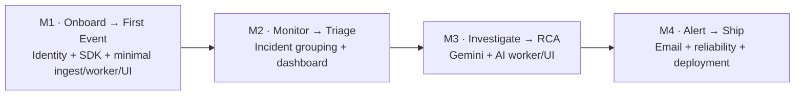

# RootTracer — MVP Execution Roadmap

**Plan:** v2.0 · **Scope:** Five locked PRD features delivered across **four vertical milestones** · **Architecture:** independent Node.js/Express/TypeScript microservices, Next.js feature-based dashboard, Node.js SDK.

**Delivery rule:** Each milestone must end with a demonstrable **browser/SDK → gateway or ingestion API → owning service → database/queue → visible user result**. Do not build every backend service first and attach the UI at the end. A milestone is complete only when its acceptance tests pass locally with real Docker dependencies.

## Baseline decisions (do not reopen while building)

- **Repo:** pnpm workspaces + Turborepo; `apps/web`, `services/{gateway,identity-service,ingestion-service,incident-service,ai-service,notification-service}`, `packages/{sdk-node,contracts,config,logger}`.
- **Frontend:** Next.js App Router, strict TypeScript, Tailwind CSS, shadcn/ui + Radix, TanStack Query, small Zustand UI store, React Hook Form + Zod, Recharts. Business code lives under `apps/web/src/features/`.
- **Backend:** Five independently deployable microservices and a thin gateway/BFF; REST for synchronous calls; RabbitMQ for asynchronous work.
- **Storage:** PostgreSQL + `pg` + service-owned versioned `.sql` migrations (the `schema.prisma` file is **documentation**, not an ORM implementation). One Postgres container is fine locally; roles/schemas remain isolated.
- **Other dependencies:** Redis (sessions/rate limits/cache), RabbitMQ (durable messages), Gemini (AI RCA), Resend (email), Mailpit (local mail testing).
- **Contract precedence:** [mvp-requirements.md](../product/mvp-requirements.md) defines feature scope; [http-api.md](../contracts/http-api.md) defines HTTP shapes; [events.md](../contracts/events.md) defines queue event versions/names; [data-model.md](../contracts/data-model.md) defines data ownership; [repository-structure.md](../architecture/repository-structure.md) defines structure. Reconcile naming mismatches in these documents **before coding consumers**.
- **Recovery:** `recovery.approved`, `recovery.completed`, approval APIs, automation, GitHub fixing, security scanning, business impact and team roles are **NOT MVP**.

## Dependency map



**Scope mapping:** PRD F1 → M1; F2/F3 → M2 (minimal happy-path groundwork in M1); F4 → M3; F5 → M4.

## Milestone 1 — Register, connect the SDK, see the first error

**User outcome:** A new developer can register, verify email, create a project, install/configure the SDK in a sample Express app, trigger an error and see that error arrive in a basic RootTracer page.

**Services brought online:** Gateway, Identity, Ingestion, minimal Incident API + telemetry worker, Next.js, Node SDK; local PostgreSQL, Redis, RabbitMQ, Mailpit. **Do not add Gemini or Resend yet.**

### Build tasks

- [ ] **M1.01 — Monorepo scaffold.** Configure pnpm workspaces, Turborepo, TS strict mode, ESLint/formatting, environment validation, `packages/contracts`, `packages/logger`, per-service Dockerfiles and health endpoints.
- [ ] **M1.02 — Local infrastructure.** Compose PostgreSQL/Redis/RabbitMQ/Mailpit + app services. Apply isolated `identity` and `incident` schema roles and service-owned SQL migrations.
- [ ] **M1.03 — Auth (vertical).** Implement `POST /api/v1/auth/register`, verify-email, login, logout, `GET /api/v1/me`; hashed passwords (Argon2id), single-use expiring verification tokens, Redis-backed HttpOnly sessions, CSRF protection.
- [ ] **M1.04 — Projects and SDK credentials.** Implement create/list/get project and create/list/revoke API keys. Store only hashed keys; show secret once; enforce owner/project isolation and key revocation.
- [ ] **M1.05 — Minimal dashboard.** Build Next.js registration/login/verify/project pages and a simple project detail page with an SDK setup snippet (use real generated key only in one-time display).
- [ ] **M1.06 — Minimal Node SDK.** Implement `captureException()`, Express middleware, async bounded batch transport, redaction, event UUID, `environment`/`release`, timeouts, `flush()` and `shutdown()`. Include both ESM/CJS builds and type declarations.
- [ ] **M1.07 — First ingest path.** Implement `POST /ingest/v1/events/batch` in independent Ingestion Service; verify project key via Identity contract/cache, validate payload, publish durable `error.ingested` with publisher confirm and mandatory routing, then return `202`.
- [ ] **M1.08 — Minimal event consumer.** Incident-owned worker consumes `telemetry.events`, inserts into a real Incident-owned SQL table with event receipts/idempotency, ACKs after commit, and exposes the latest project event through a project-scoped Incident API. A basic incident record may be created here; full grouping is M2.
- [ ] **M1.09 — First-event UI.** Show the latest sanitized error on the project detail page through gateway → Incident Service. Display an empty state and connection checklist before the first event.
- [ ] **M1.10 — Contract/security tests.** Test session security, cross-project access denial, invalid/revoked keys, wrong SDK schema, SDK batching/redaction, broker unavailable (`503` not false `202`), and consumer replay after commit.

### Working demo

1. Start the stack with Docker Compose; visit Next.js.
2. Register → read verification email in Mailpit → verify → log in → create project and SDK key.
3. Install/configure SDK in `tests/fixtures/demo-node-app/` and trigger a deliberate Express error.
4. Observe HTTP `202` from Ingestion; the real telemetry queue/worker persists it.
5. Refresh the project page; one sanitized error is visible for the correct project.

### Exit gate (all required)

- [ ] Test error appears **without manual SQL edits or direct queue publishing**.
- [ ] Replaying same `event_id` causes **one** stored occurrence only; worker only ACKs after successful commit.
- [ ] Wrong project/key or revoked key cannot ingest; unrelated user cannot read incidents.
- [ ] Neither SDK nor UI reveals API-key secrets after one-time display; no passwords/cookies/bodies in event metadata.
- [ ] Automated happy-path integration test and initial Playwright onboarding smoke test pass.

**Deliverable tag:** `mvp-m1-first-event`

## Milestone 2 — Error monitoring, grouping and developer dashboard

**User outcome:** Developer can discover, filter and inspect production errors, see repeat occurrences grouped by fingerprint, change incident status and follow an incident over time.

**Build on:** M1 Identity, SDK, gateway, ingestion, queue, Incident Service and basic UI. No separate new microservice.

### Build tasks

- [ ] **M2.01 — Complete Incident-owned SQL migrations.** Add `incidents`, `raw_events` partitioned by `occurred_at` (daily), `event_receipts`, `incident_activities`, `incident_outbox`, indexes and retention tasks. Retain raw telemetry for 30 days.
- [ ] **M2.02 — Deterministic grouping.** Implement normalized stack + exception type + `project_id` + `environment` fingerprint. Unique upsert guards and atomic occurrence count updates. Regression after previously resolved incident.
- [ ] **M2.03 — Incident lifecycle.** `OPEN → INVESTIGATING → RESOLVED → REGRESSED`, severity rules/override, first/last seen, activity timeline and validated state transitions.
- [ ] **M2.04 — Real read APIs.** Implement dashboard summary, incident list/filter/search/cursor pagination, detail, event history, activity and status patch endpoints from [http-api.md](../contracts/http-api.md). Every query is project scoped and correctly authorized.
- [ ] **M2.05 — Feature-based UI.** Implement `features/monitoring`, `features/incidents`, project switcher, overview metrics, incident table/details, activity history, empty/loading/error states, time range and environment filters.
- [ ] **M2.06 — Charts and refresh.** Recharts trend/severity visualization; TanStack Query fetching with **15-second conditional polling**, query invalidation after user status changes; shareable URL filters.
- [ ] **M2.07 — SDK robustness.** Cover uncaught exceptions/unhandled rejections without replacing the host application's own handlers, retries with bounded memory, retries/backoff on transient network errors, fail-safe shutdown, default redaction, and configurable sampling.
- [ ] **M2.08 — Outbox and operational safeguards.** Add Incident transactional outbox and publisher skeleton for future alert triggers; partition creation/retention job; basic health/queue backlog metrics and request correlation.
- [ ] **M2.09 — Database + contract tests.** Test concurrent duplicate batches, multi-environment separation, high-volume paging, invalid transitions, stack fingerprint stability, outbox delivery after worker crash, partition boundaries and retention.

### Working demo

1. Trigger the **same** error 10 times and a **different** error twice from the sample app, then send the first error in a second environment.
2. Dashboard groups repeated occurrences, shows correct counters/trends and keeps environments isolated.
3. Filter/search incidents, open one, view its sanitized event history, mark resolved, then re-trigger it.
4. Observe the incident transition to **REGRESSED**, with an activity entry and updated metrics.

### Exit gate

- [ ] 10 repeated events become **one incident with 10 occurrences** (assuming no sampling, no duplicate event IDs).
- [ ] Same fingerprint in different environments does **not** merge incidents.
- [ ] Incident status, activity, filtering, cursor pagination and dashboard charts work end to end.
- [ ] Redis/RabbitMQ/DB errors produce explicit safe error states; consumer replays never double-count.
- [ ] Project isolation, retention/partition boundary tests and Playwright monitoring smoke tests pass.

**Deliverable tag:** `mvp-m2-monitoring`

## Milestone 3 — Request and review AI Root Cause Analysis

**User outcome:** A developer opens an incident, clicks **Investigate with AI**, sees progress, then receives an evidence-based probable cause and suggested fix without exposing application secrets.

**New service:** AI Investigation Service (API + independently scalable worker). Existing Incident Service exposes a **sanitized, authenticated internal evidence API**.

### Build tasks

- [ ] **M3.01 — AI service ownership.** Create independent Express API, worker entry point, health endpoint, Dockerfile, AI schema/role and SQL migrations for `ai_rca_reports` plus an **AI-owned transactional enqueue outbox**.
- [ ] **M3.02 — Investigation HTTP contracts.** Implement create/list/get investigation endpoints. Verify authenticated ownership through gateway and internal service authorization.
- [ ] **M3.03 — Durable request workflow.** Persist `PENDING` + outbox in one AI transaction; publish `rca.requested` to `ai.investigations`; consume with manual ACK, retry/backoff, dedupe and DLQ.
- [ ] **M3.04 — Internal evidence fetch.** AI worker requests incident context using Incident's versioned internal REST API (not Incident SQL). Bound event count, sanitize stack/context, include environment/release/history and avoid secrets.
- [ ] **M3.05 — Gemini integration.** Prompt/model versioning, provider timeouts, bounded concurrency, project usage quotas and structured result parsed/validated with Zod; persist status `PENDING → PROCESSING → COMPLETED/FAILED`.
- [ ] **M3.06 — Smart caching.** Cache/reuse completed investigations when the same evidence hash is still valid; offer re-investigation when there is new evidence.
- [ ] **M3.07 — AI feature UI.** `features/ai-investigation`: one-click request, pending/processing states, likely causes + linked evidence + suggested checks/fixes + uncertainty, history and retryable failure display.
- [ ] **M3.08 — Fault/security tests.** Fake Gemini success/timeout/429/malformed JSON; worker restart; unsupported event schema; output size constraints; cache hit; multi-tenant authorization; prove AI outage never blocks ingestion.

### Working demo

1. Open an M2 incident and click **Investigate with AI**.
2. UI displays request as pending/processing while the AI worker runs from RabbitMQ.
3. A **structured probable-cause report** appears, with evidence, limitations and suggested fixes.
4. Re-open/report with unchanged evidence; show cache behavior. Trigger a new event and investigate with the new evidence hash.
5. Simulate provider timeout and show safe failure/retry without stopping error monitoring.

### Exit gate

- [ ] AI service never queries Incident-owned PostgreSQL tables.
- [ ] Request is durably saved **and** reliably scheduled even if publisher/worker restarts.
- [ ] Gemini result is schema validated and tied to exact project/incident/evidence version.
- [ ] No unsupported certainty claims or sensitive credentials appear in AI evidence/result.
- [ ] Contract, integration and browser investigation tests pass with mocked provider; optional live Gemini test is opt-in.

**Deliverable tag:** `mvp-m3-ai-rca`

## Milestone 4 — Email alerts, resilience and a deployable MVP

**User outcome:** A developer receives actionable email when a qualifying new/critical/regressed incident occurs, can tune alert settings, and the entire MVP operates reliably in a deployed environment.

**New service:** Notification Service (worker). Integrate Resend in deployed environments and Mailpit locally.

### Build tasks

- [ ] **M4.01 — Alert rules.** Add project-scoped alert preferences and severity/event criteria; implement GET/PATCH alert-settings API and `features/notifications` settings UI.
- [ ] **M4.02 — Incident → email event.** Incident Service emits notification events from its **transactional outbox**; version the `notifications.email` payload in `packages/contracts`, distinct from `error.ingested` and `rca.requested`.
- [ ] **M4.03 — Independent notification worker.** Consume `notifications.email` with manual ACK, delivery idempotency, cooldown, bounded retries and dedicated DLQ. Persist attempts/state in Notification-owned SQL schema.
- [ ] **M4.04 — Email providers.** Implement provider adapter (Resend production, Mailpit/local SMTP or local adapter). Deliver new/critical/regressed incident links, with sanitized content; handle provider retry and permanent bounce errors safely.
- [ ] **M4.05 — Account/project completion.** Add password reset, project rename/delete with 7-day soft-delete purge, key rotation and emergency revoke. Ensure async services honor deletion lifecycle events.
- [ ] **M4.06 — Cross-service production hardening.** Cookie/CSRF/CORS, secret handling, rate limits, request/trace IDs, internal service authentication, database role isolation, backpressure, health probes, worker graceful shutdown and alerting on queue backlog/DLQs.
- [ ] **M4.07 — CI and release pipeline.** GitHub Actions for lint/type/unit/contract/integration/e2e tests; build separate images; dev/staging/prod configs; manually approved production release. Local Docker Compose remains first-class.
- [ ] **M4.08 — Infrastructure and deployment.** Add Kubernetes manifests/Helm releases, HPA/KEDA where useful, Terraform for chosen cloud, Redis/RabbitMQ/Postgres managed configuration, migration jobs, safe rolling deploy and rollback; test locally via kind/k3d before cloud.
- [ ] **M4.09 — Restore and load readiness.** Backups/PITR runbook, verify restore drill, 100 events/sec sustained + 500 events/sec burst load **targets** with recorded measurements; tune connection pools, queue prefetch, storage and partitions.
- [ ] **M4.10 — End-to-end release tests.** Onboarding → SDK event → incident grouping → dashboard → Gemini RCA → email. Test mail cooldown, replay, failed provider, DLQ, project isolation and deleted-project cleanup.
- [ ] **M4.11 — Developer documentation.** README, setup/SDK guide, local bootstrap, API docs (OpenAPI), architecture/queue diagrams, service ownership map, incident support runbook, environment templates and operational troubleshooting.
- [ ] **M4.12 — Freeze release scope.** Validate PRD acceptance criteria; exclude Recovery Action worker/endpoints/queues from deployment, and confirm no business impact or GitHub fixing code is active.

### Working demo

1. In a running environment, trigger a new critical incident with an onboarded sample app.
2. Observe the incident on the dashboard and an **email notification** via Mailpit (local) or Resend (staging/prod).
3. Re-trigger within cooldown: incident occurrence updates but **does not spam additional emails**.
4. Resolve and re-trigger the incident: observe regression logic and eligible alert; investigate with Gemini.
5. Kill/restart workers and temporarily stop provider/broker; show recovery, bounded retry and DLQ handling. Run CI and deploy/rollback rehearsal.

### Exit gate

- [ ] All five locked PRD features work in one uninterrupted end-to-end demo.
- [ ] One logical alert obeys configured cooldown and idempotency; provider failures are visible and retryable.
- [ ] Authentication, authorization and tenant boundary tests pass across all services.
- [ ] CI passes; independently built images run via Compose and a local Kubernetes deployment.
- [ ] Record measured throughput/latency against targets rather than claiming untested capacity.
- [ ] Logs, health probes, backups/restore drill, DLQ handling and deployment rollback are documented and tested.
- [ ] **No Smart Recovery endpoints, recovery workers, or recovery RabbitMQ queues are deployed.**

**Deliverable tag:** `mvp-v1-release`

## Shared engineering checklist (apply in every milestone)

| Gate | Requirement |
|---|---|
| API contract | Versioned request/response Zod validation; standardized error JSON + `request_id` |
| Async contract | JSON Schema/version; durable publish confirm; retries + DLQ; idempotent consumer |
| DB ownership | Own `pg` pool, role and SQL migrations; no direct cross-service SQL |
| Security | Auth/authorization/CSRF where appropriate; secret redaction; tenant isolation tests |
| Observability | Pino JSON logs, correlation IDs, worker/health metrics and failure states |
| Tests | Unit → real DB/broker integration → API/event contracts → browser/SDK demo |
| Release | Docker image, readiness/health, config validation, graceful shutdown |
| Docs | Update [http-api.md](../contracts/http-api.md), [events.md](../contracts/events.md), [data-model.md](../contracts/data-model.md) and runbooks when contracts change |

**Suggested test tooling:** Vitest + Supertest; Docker-backed PostgreSQL/RabbitMQ/Redis integration tests; React Testing Library for components; Playwright for browser E2E; a sample Express app as SDK fixture; a load generator (e.g., k6) for final measurements.

### Practical development loop

1. Make one testable story end-to-end: UI or SDK → HTTP API → owned database/event → user-visible result.
2. Write/update public and internal contracts first; include negative security cases.
3. Run affected unit tests, then real dependency integration/contract tests.
4. Run the milestone demo through the browser and sample Node app.
5. Merge only when milestone exit gate is verifiable; log known limitations in README/issues.

### Canonical commands (planned scripts; implement during M1)

```bash
pnpm install
pnpm infra:up          # Docker Compose infrastructure
pnpm db:migrate         # Each service executes ONLY its own SQL migrations
pnpm dev                # Turborepo watch tasks
pnpm lint
pnpm typecheck
pnpm test
pnpm test:integration
pnpm test:e2e
pnpm build
```

These are **target script names**, not claims that a working repository or commands already exist.

## MVP acceptance

**Developer registers → verifies email → creates project/API key → configures SDK → sends error → RabbitMQ persists event → dashboard groups/displays incident → developer requests Gemini RCA → email alert is delivered when conditions match.**

The four milestones deliver that journey incrementally, without starting Smart Recovery or changing the five-feature MVP lock.

## Scope / dependency risks to watch

- **Distributed-system complexity in M1:** A first-event vertical slice requires multiple processes. Keep implementations minimal, not mocked across service boundaries, but postpone nonessential features to M2–M4.
- **Auth + public ingest race:** Short-lived API-key cache must account for revocation; fail closed on unverifiable keys.
- **Event contract inconsistency:** Canonical v1 `error.ingested` and `rca.requested` in [events.md](../contracts/events.md) supersede older example routing names; reconcile documentation/consumers before wiring.
- **Partition deduplication:** Partitioned raw events can't enforce global event UUID uniqueness alone; `event_receipts` and transactional updates handle replay.
- **AI availability/cost:** AI is explicitly on-demand; quotas, cached results and bounded concurrency keep monitoring functional independently.
- **Email delivery semantics:** Avoid claiming exactly-once external email delivery; use durable dedupe, provider IDs, cooldown and incident-specific decisions.

**Definition of completion:** No milestone is done merely because code compiles; it requires the demo, tests and exit gate above.
