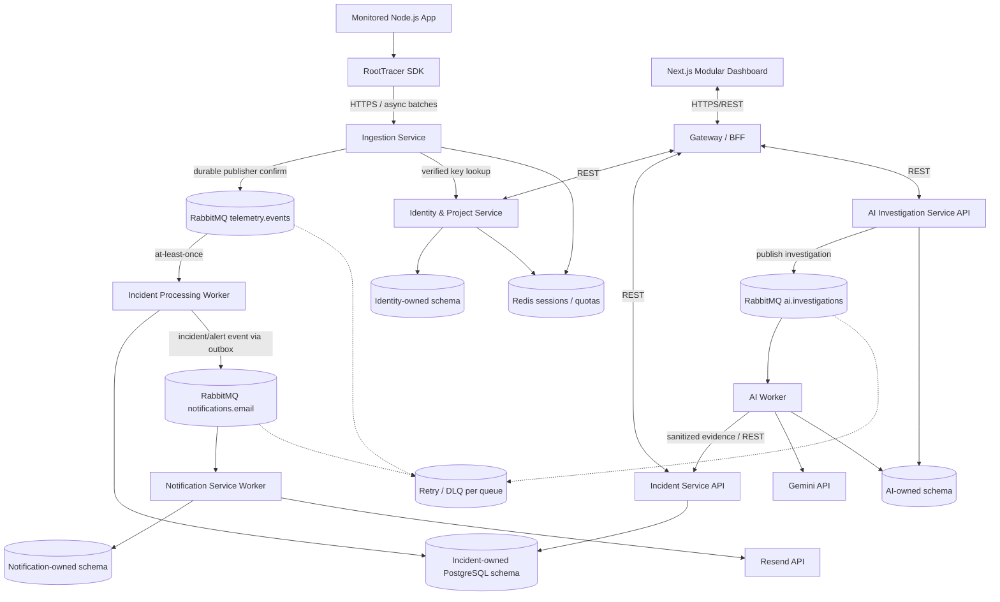

# RootTracer — MVP Implementation Plan

**Product:** RootTracer — AI-powered Error Monitoring and Investigation Platform  
**Architecture:** Independently deployable Express/TypeScript microservices + modular Next.js frontend  
**Source of technical detail:** [technical-requirements.md](../architecture/technical-requirements.md)  
**Supersedes:** The earlier modular-monolith MVP plan.

> **Design goal:** Deliver a real, end-to-end monitoring SaaS with independent service ownership. The MVP is production-oriented, but performance and availability remain validation targets rather than guaranteed claims.

## 1. MVP scope

| MVP module | Deliverable |
|---|---|
| **Node.js Monitoring SDK** | Public TypeScript npm package for Node.js 22/24, with manual exception capture, automatic uncaught exception/unhandled rejection hooks, opt-in Express error middleware, privacy-first event context, bounded batching/retries, configurable sampling, and graceful flush/shutdown. |
| **Identity & Projects** | Email/password signup, verification and password reset; Redis-backed browser sessions; project creation; rotatable ingestion keys and onboarding instructions. |
| **Error Monitoring** | Ingestion, RabbitMQ telemetry pipeline, PostgreSQL event storage and incident grouping, fingerprinting, occurrence tracking, severity, incident lifecycle/regressions, release/environment filters, full-text search and history. |
| **Developer Dashboard** | Approved **Concept A — Clear Overview** light theme; monitoring metrics, 24h/7d trends, latest and recurring incidents, detail views, project settings and SDK setup. |
| **AI Investigation** | On-demand Google Gemini analysis using sanitized incident evidence, structured JSON/Zod validation, versioned investigation history, limits, caching, and explicit uncertainty. |
| **Email Notifications** | Dashboard alert indicators and Resend emails for new/critical/regressed/frequency-threshold incidents; independent RabbitMQ notification worker, deduplication, cooldown and retry handling. |

### Explicitly outside the MVP

- GitHub repository integration, AI code patch generation or automated PRs.
- Smart Recovery Engine, production retries or any autonomous changes to customer systems.
- Business Impact Tracker and automatic business-operation inference.
- Dedicated security-scanning product, multi-user teams/roles, advanced reporting exports, Slack/Discord integrations, AI chat, and full distributed APM tracing UI.
- Multi-language monitoring SDKs (beyond the first Node.js SDK).

The future HLD can reserve extension points for excluded features, but they must not appear as working MVP flows.

## 2. Technology stack

| Layer | Technology | Decision |
|---|---|---|
| **Frontend** | **Next.js App Router + TypeScript (strict)** | One frontend app, feature-based modular architecture |
| Styling & UI | Tailwind CSS, shadcn/ui, Radix UI | Implement RootTracer's approved light-theme design |
| Frontend data | TanStack Query | API fetching/caching, 15-second polling (pause in background tabs) |
| Frontend state | Zustand | Lightweight shared UI state only; URL owns shareable filters |
| Forms & validation | React Hook Form + Zod | Typed forms and validation |
| Charts | Recharts | Error trends and severity/incident metrics |
| Backend | Node.js + Express + TypeScript | Five independently deployable microservices + thin API Gateway/BFF |
| API standards | REST `/api/v1`, OpenAPI, Zod | Versioned API and event contracts |
| SDK | TypeScript; OpenTelemetry-compatible integration | Public npm package; first-class Node.js/Express capture |
| Database | PostgreSQL via `pg` | **Service-owned DB schemas/databases**, parameterized SQL, versioned SQL migrations |
| Queue | RabbitMQ | Per-responsibility durable queues, publisher confirms, retry and DLQ |
| Cache & sessions | Redis | Browser sessions, bounded quotas, key lookup cache, notification cooldown |
| AI | Google Gemini API | On-demand, evidence-based RCA; validated structured responses |
| Email | Resend API; Mailpit locally | Transactional notifications and local delivery testing |
| Logging | Pino | Structured logs, request/trace IDs and service health checks |
| Monorepo | pnpm workspaces + Turborepo | Shared contract packages, independent service outputs |
| Local environment | Docker Compose | Postgres, RabbitMQ, Redis, Mailpit, services and optional web |
| K8s local testing | `kind` or `k3d` | Verify Helm deployments before managed-cloud provider choice |
| Production infrastructure | Kubernetes + Helm + Terraform | Independent services, HPA for API pods and KEDA for queue workers |
| CI/CD | GitHub Actions | Lint/type-check/tests; build each image; production approval gate |
| Testing | Vitest, Supertest, React Testing Library, Playwright | Unit + integration + contract + end-to-end; Docker test dependencies |

### Frontend architecture rules

1. `app/` defines Next.js routes, layouts and rendering boundaries, **not** business logic.
2. `features/<feature>/` owns its components, typed API functions, schemas, hooks, feature-specific types and public `index.ts`.
3. Shared `components/ui` contains design-system primitives; feature components stay inside features.
4. TanStack Query holds server state; Zustand is only for local shared UI state. Do not duplicate incident API data in Zustand.
5. The browser talks to the **Gateway/BFF** over HTTPS. It never calls internal services, RabbitMQ, PostgreSQL or Gemini directly.
6. Keep sensitive keys/session details server-side and use secure HttpOnly cookie sessions; enforce CSRF protection on state-changing browser requests.

## 3. MVP architecture — HLD v2



**Synchronous paths:** Browser → BFF → authenticated internal REST services; SDK → Ingestion; AI worker → Incident evidence API; workers → their own PostgreSQL schema; external calls to Gemini/Resend.

**Asynchronous paths:** Ingestion → telemetry queue → incident worker; AI service → investigation queue → AI worker; incident alert outbox → notification queue → email worker.

**Critical acceptance rule:** Ingestion returns **`202 Accepted` only after RabbitMQ confirms durable acceptance** of the valid, atomic batch. It does **not** mean the incident is already stored or analyzed.

### Five independent microservices

| Service | Owns | Interface | Deployables |
|---|---|---|---|
| **Identity & Project** | Accounts, verified email, Redis sessions, projects, ingestion keys, project deletion | REST internal/public via BFF | HTTP API |
| **Ingestion** | API key verification, rate limits, payload validation, broker publish | Public HTTPS `/ingest/v1` | HTTP API |
| **Incident** | Fingerprinting, events, incident state, search/trends, alert decisions/outbox | REST through BFF; consumes telemetry | HTTP API + telemetry worker |
| **AI Investigation** | Investigation jobs, Gemini access, results, cache/rate controls | REST through BFF; consumes AI jobs | HTTP API + AI worker |
| **Notification** | Delivery records, cooldown, email retries and errors | Consumes alert messages | Email worker (private management/health optional) |

**Gateway/BFF is an entry-point component, not a sixth domain service.** It only routes/coordinates authenticated frontend requests and enforces request-level controls.

### Service-owned data model

- A single PostgreSQL **server/cluster** is acceptable for initial deployment, but Identity, Incident, AI and Notification each use **separate schemas or databases, database users, migrations and repository code**.
- **No cross-service SQL joins, writes, foreign keys or direct DB access.** Use versioned REST APIs and RabbitMQ integration events with immutable IDs.
- Incidents own the 30-day, daily-partitioned `events` dataset, deduplication receipts, lifecycle state and severity. AI owns investigation history and references incident IDs rather than reading incident tables.
- Project deletion propagates via authenticated events/commands; each owning service cleans up its data idempotently within the approved deletion policy.

## 4. Monorepo and folder structure

```text
roottracer/
├── apps/
│   └── web/                              # Next.js App Router
│       ├── src/
│       │   ├── app/
│       │   │   ├── (auth)/                # Login, signup, verify, reset
│       │   │   ├── (dashboard)/           # Protected routes and layouts
│       │   │   ├── layout.tsx
│       │   │   └── providers.tsx
│       │   ├── features/
│       │   │   ├── authentication/
│       │   │   ├── projects/
│       │   │   ├── monitoring/
│       │   │   ├── incidents/
│       │   │   ├── ai-investigation/
│       │   │   ├── notifications/
│       │   │   └── settings/
│       │   ├── components/
│       │   │   ├── ui/                   # shadcn/ui + Radix primitives
│       │   │   └── layout/               # App shell, sidebar, header
│       │   ├── lib/                      # API client, query keys, utilities
│       │   ├── hooks/                    # Only cross-feature hooks
│       │   ├── stores/                   # Minimal Zustand UI stores
│       │   └── styles/
│       ├── public/
│       ├── tests/
│       └── Dockerfile
│
├── services/
│   ├── gateway/                          # Thin BFF / API entrypoint
│   ├── identity-service/                 # Users, projects, keys, sessions
│   ├── ingestion-service/                # SDK HTTPS ingestion
│   ├── incident-service/                 # Incidents API + worker
│   │   ├── src/{api,domain,workers,repositories,messaging}/
│   │   └── migrations/
│   ├── ai-service/                       # Investigation API + AI worker
│   │   ├── src/{api,domain,workers,repositories}/
│   │   └── migrations/
│   └── notification-service/             # Email queue consumer
│
├── packages/
│   ├── sdk-node/                         # Public npm monitoring SDK
│   ├── contracts/                        # Versioned public API + event schemas
│   ├── logger/                           # Pino, request IDs
│   └── config/                           # Typed/Zod environment validation
│
├── infrastructure/
│   ├── docker/compose.yaml               # Local services
│   ├── kubernetes/local/                 # kind/k3d manifests
│   ├── helm/                             # Independent releases
│   └── terraform/                        # Cloud provisioning
│
├── scripts/                              # Bootstrap, migrations, scheduler
├── tests/
│   ├── contracts/
│   ├── integration/
│   ├── e2e/
│   ├── load/
│   └── fixtures/demo-node-app/
├── docs/{architecture,contracts,product,planning,engineering,sdk,runbooks}/
├── .github/workflows/
├── pnpm-workspace.yaml
├── turbo.json
└── package.json
```

**Example frontend feature:**

```text
apps/web/src/features/incidents/
├── api/               # Typed fetch functions, query keys
├── components/        # IncidentTable, IncidentFilters, IncidentDetails
├── hooks/             # useIncidents, useIncident
├── schemas/           # Zod payload/query schemas
├── types/             # Incident-specific types
└── index.ts           # Feature public interface
```

**Repository boundary:** Shared `packages/contracts` may share Zod interfaces or message contracts. No microservice may import another service's repository, model implementation or private business logic.

## 5. MVP product screens

The implementation follows the approved 17-page Canva Concept A design, **but only MVP screens become functional now**.

| MVP page/flow | Behavior |
|---|---|
| Signup, verification, login, password reset | Secure Redis-backed session lifecycle |
| Project onboarding | Create project and reveal new ingestion key once; SDK setup instructions |
| Monitoring overview | Trends, counts, environment/release filters, latest incidents |
| Incident Explorer | Search, severity/status filters, cursor pagination |
| Incident Details | Sanitized stack, occurrences, first/last seen, release, activity timeline, status changes |
| AI Investigator | Click-to-investigate, queued/processing/completed/failed states, evidence, probable causes, recommendations |
| Notifications / settings | Alert configuration, cooldown, Resend delivery status, project key rotation |

Smart Recovery, GitHub AI fixing, security analysis and Business Impact pages can remain **future-feature design references**, but must not be presented as functional MVP features.

## 6. Implementation phases and definition of done

### Phase 1 — Monorepo + Infrastructure Foundation

**Build:** pnpm/Turborepo, lint/TS rules, versioned contracts, Pino/logger, Docker Compose, separate Postgres schemas + users, RabbitMQ, Redis, Mailpit; basic health endpoints, service Dockerfiles and CI quality gates.

**Done when:** All services boot locally, have healthy dependency checks and isolated DB credentials, and the contract tests run.

### Phase 2 — Identity & Project Service + Gateway

**Build:** email/password auth, Argon2id, email verification/reset, Redis sessions with secure cookies, CSRF protection, project ownership, rotatable project ingestion keys, ownership/session validation through BFF, versioned APIs.

**Done when:** A user can safely sign up, verify, log in, create a project and generate/revoke a scoped SDK key.

### Phase 3 — Node.js SDK + Ingestion Service

**Build:** npm SDK, Express middleware, capture hooks, sanitization, batching, bounded retries/backoff, `flush`/`shutdown`, sampling, `/ingest/v1`, key lookup, Zod payload validation, per-project rate limiting, RabbitMQ publisher confirms, structured `202` responses.

**Done when:** A controlled exception in the demo app produces a durable telemetry message without blocking the host app.

### Phase 4 — Incident Service + Processing Worker

**Build:** durable telemetry consumers, manual ACK after DB commit, deterministic fingerprinting, unique event receipt/idempotency logic, daily Postgres event partitions, incident grouping, environment/release, status/regression, severity, history, optimized filters/search and REST endpoints. Introduce outbox-based alert triggers.

**Done when:** SDK errors appear exactly once in the incident occurrence count despite message redelivery; repeated similar errors group correctly; other projects' data is inaccessible.

### Phase 5 — Next.js Modular Dashboard

**Build:** Auth/project/monitoring/incidents/settings feature modules, reusable light-theme components, typed gateway client, TanStack Query caching/polling, TanStack/URL filter state, accessible forms, responsive layouts and Recharts.

**Done when:** A developer can connect a project, see trend charts, filter incidents and inspect error history from the dashboard.

### Phase 6 — AI Investigation Service

**Build:** on-demand investigation request API, RabbitMQ AI queue/worker, per-project admission/concurrency limits, sanitized evidence fetched via Incident REST API, Gemini prompts, structured JSON/Zod validation, versioned investigation records, safe retries and failure states.

**Done when:** An incident investigation yields an evidence-based probable root cause and suggested fix, with uncertainty shown; Gemini outages do not interrupt event monitoring.

### Phase 7 — Notification Service

**Build:** independent email consumer, Resend provider adapter, local Mailpit integration, alert rules/cooldowns, delivery receipts, bounded retries/DLQ and notification settings UI.

**Done when:** A qualifying incident generates one deduplicated alert email, repeated events honor cooldown and provider failures do not block ingestion.

### Phase 8 — Hardening, End-to-End Validation & Deployment

**Build/test:** SDK unit tests, service contract/integration tests, Playwright journeys, real Node.js app SDK trial, access-isolation tests, queue outage/replay scenarios, 30-day retention and deletion jobs, CI/CD images, kind/k3d + Helm validation, Terraform/cloud runbook, readiness/liveness probes, HPA/KEDA policies, backups/PITR restore runbook.

**Done when:** End-to-end journey works in local/staging, CI is green, recovery drills and failure tests are documented, and production release approval can be performed safely. No untested performance/availability guarantee is claimed.

> **Development sequence:** Although backend deployments are independent, deliver a vertical slice early (Identity → Ingestion → Incident → minimal Dashboard), then expand AI and Notifications. Avoid building every service fully in parallel.

## 7. Reliability, performance, and security rules

| Concern | MVP rule |
|---|---|
| **Event throughput target** | 100 events/s sustained, 500 events/s burst; **must be benchmarked**, not assumed |
| **Retention** | 30 days of individual event data with daily PostgreSQL partitions; longer-lived incident summaries |
| **Event processing** | At-least-once RabbitMQ delivery; deterministic event IDs; atomic PostgreSQL transaction and idempotent updates |
| **Publisher behavior** | `202` only after broker confirms durable batch; `429/503` with `Retry-After` where appropriate |
| **Worker fault tolerance** | Separate durable queues, prefetch/concurrency bounds, limited exponential-backoff retries, DLQs, graceful shutdown |
| **Incident fingerprint** | Scoped by project + environment + normalized error signature; separate from unique event ID |
| **SDK safety** | Non-blocking and bounded, no sensitive data by default, request timeouts; lost events possible on forced crashes/full buffers |
| **Sessions and ownership** | Redis sessions/HttpOnly cookies; project-scoped authorization at every service boundary; CSRF protection |
| **Secrets** | Local untracked `.env`; production secret manager; keys never leaked in browser/logs |
| **AI safety** | Sanitized bounded context; suggestions labeled as hypotheses; no automatic recovery; Gemini request caps and timeouts |
| **Scaling** | Independent service deployments; HPA for API instances, KEDA for queue workers, bounded `pg.Pool` connection budget |
| **Backups** | Managed PostgreSQL PITR with documented restore tests; RPO 15 minutes / RTO 2 hours are **targets** |
| **Service health** | Pino logs, request IDs, health endpoints, consumer status; basic monitoring (advanced SRE tooling deferred) |
| **Deployment** | Development / staging / production; rolling updates, probes, graceful shutdown, Helm rollback and manual release approval |

**Partitioned ID uniqueness:** PostgreSQL partitioning constraints do not automatically enforce global uniqueness of `event_id` across daily partitions. Use a transactionally controlled receipt/idempotency strategy with a documented retention window; test duplicate redelivery across day boundaries. Carefully design cleanup so replayed expired events cannot corrupt counts.

**Cross-service consistency:** Local SQL transactions do not form a global transaction. Use transactional outbox + independently idempotent consumers for alert/project-lifecycle events, retry handling and service-owned cleanup.

**Kubernetes costs:** k3d/kind local first; the production managed provider is not yet selected. Microservices and Kubernetes increase operational complexity compared with the original monolith plan.

## 8. MVP user journey

1. Developer creates and verifies a RootTracer account.
2. Developer creates a project and obtains an ingest-only API key.
3. Developer installs the TypeScript Node.js SDK, configures environment/release and instruments Express errors.
4. SDK captures and sanitizes an error, batches it, and sends it to Ingestion Service.
5. Ingestion verifies the key, validates input, and publishes a durable RabbitMQ message.
6. Incident worker processes and stores the event, groups it with its incident and updates counts without double counting.
7. Dashboard displays the incident and trends after its next poll.
8. Developer opens incident details and clicks **Investigate with AI**.
9. AI Service requests sanitized incident context, calls Gemini, persists structured findings and displays uncertainty.
10. A qualifying incident generates a deduplicated email alert via the Notification Service.
11. Developer changes incident state; subsequent matching events trigger regression tracking if applicable.

## 9. MVP acceptance checklist

- [ ] Public SDK works with Node.js 22 and 24 and Express integration, including graceful shutdown.
- [ ] Separate microservices have independent configs, migration ownership, images, health endpoints and restricted credentials.
- [ ] SDK errors flow via HTTPS → durable RabbitMQ → Incident-owned PostgreSQL → Dashboard.
- [ ] Broker failures return controlled errors; duplicate/redelivered events never double-increment incidents.
- [ ] Project ownership is enforced on every read/write path, and SDK ingestion keys cannot access dashboard/management APIs.
- [ ] Daily partitions, retention cleanup, event receipts, and cursor pagination operate correctly.
- [ ] Dashboard matches Concept A and includes monitoring trends, search/filters, incident details and 15-second polling.
- [ ] Gemini investigations are on-demand, structured, sanitized, cached/limited and show failure/uncertainty states.
- [ ] Resend emails honor alert rules, rate limiting and cooldown; delivery failures are isolated.
- [ ] Unit, integration, contract, E2E and real-app tests pass; throughput target is evaluated with load tests.
- [ ] Docker Compose local environment, local Kubernetes validation, CI/CD and staging deployment are documented.
- [ ] No GitHub code analysis, automatic production recovery or business impact claims appear as functional MVP features.

## 10. Engineering deliverables

Before writing major feature code, prepare the **LLD** using the TRD v2 baseline:

1. Per-service database schema and versioned SQL migrations; event receipts, time partitions and ownership constraints.
2. OpenAPI contracts: Identity, Ingestion, Incident, AI, gateway/BFF; authorization model and structured error responses.
3. RabbitMQ exchange/queue/binding declarations, retry/DLQ policy, event schema versions and outbox publisher.
4. SDK public API, event schema, lifecycle/flush semantics and redaction rules.
5. Frontend feature module interfaces, route map, data fetching, component boundaries, and design tokens.
6. Deployment manifests, service-to-service auth, Helm/KEDA configuration and tests.

**Final architectural principle:** One repository, one modular Next.js application, **independently deployable backend microservices with private owned data**, and reliable asynchronous communication. Do not reintroduce a shared application database access layer or combine all backend services into one deployable.
