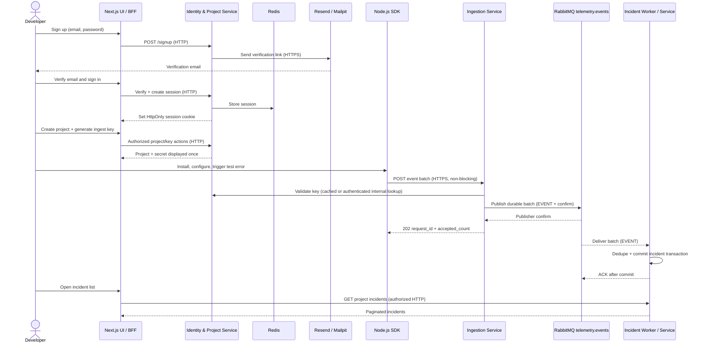
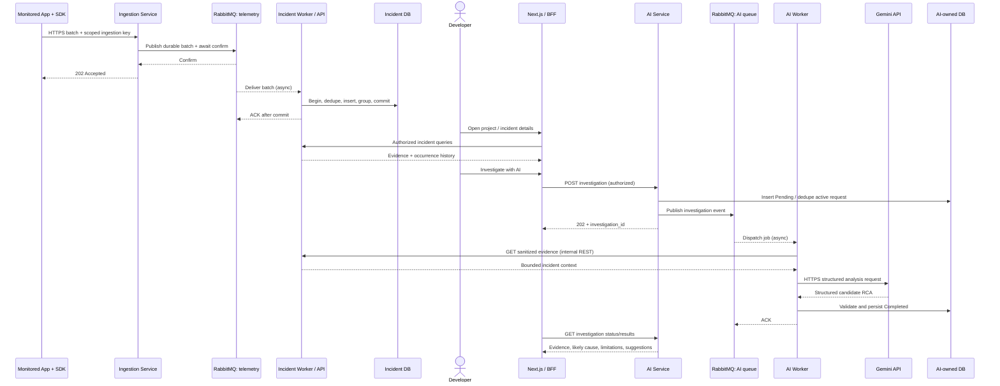
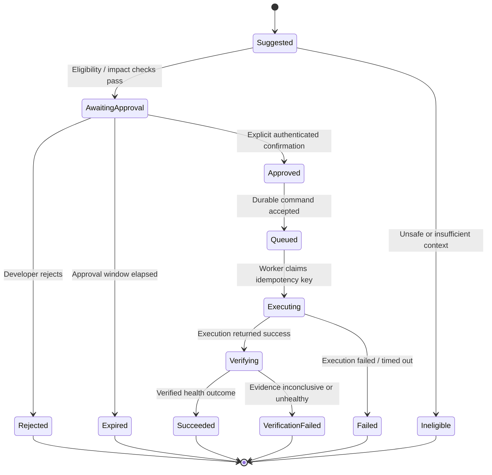
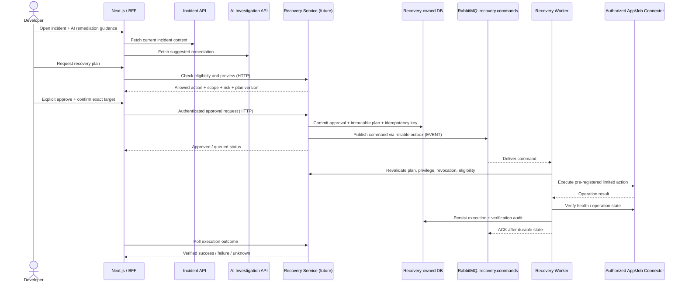

# RootTracer — User & System Flows

**Version:** 1.0 · aligned with RootTracer PRD MVP scope and HLD/TRD v2  
**Status:** Engineering specification  
**Architecture:** Next.js App Router (feature-based UI) · Express/TypeScript microservices · RabbitMQ · PostgreSQL (`pg`) · Redis · Google Gemini · Resend

## 0. Scope and conventions

This document covers three end-to-end journeys:

1. **Developer onboarding and SDK setup — MVP**
2. **Error ingestion through AI root-cause investigation — MVP**
3. **Human-in-the-loop recovery approval — FUTURE PHASE; NOT IN MVP**

The locked MVP contains account/project/SDK onboarding, error monitoring, dashboard, on-demand Gemini investigation, and email alerts. **Automated recovery, GitHub fixes/PR generation, security scanning, and business-impact tracking are not MVP deliverables.** The future recovery flow below is a specification for later implementation only; the MVP must not expose a working “Execute Recovery” action.

### Actors and boundaries

| Actor / system | Responsibility |
|---|---|
| Developer | Owns a RootTracer account and project; installs SDK; reviews incidents and AI output |
| Next.js web app | Feature-based UI for auth, projects, onboarding, monitoring, incidents, AI, notifications |
| API Gateway/BFF | Browser entrypoint; session/CSRF checks, authenticated routing; no domain ownership |
| Identity & Project Service | Signup/login, verification, Redis sessions, project ownership, SDK key issue/rotation/revocation |
| Ingestion Service | SDK auth, schema and payload validation, project quotas; durable RabbitMQ publish before `202` |
| Incident Service + telemetry worker | Event dedupe, incident fingerprint/grouping, lifecycle, trends, activity, notification triggers |
| AI Investigation Service + worker | On-demand queueing, limited concurrency, safe context retrieval, Gemini calls, versioned results |
| Notification Service + worker | Email alert delivery via Resend; cooldown, retry, DLQ |
| PostgreSQL | Service-owned schemas/databases with independent credentials/migrations; no cross-service SQL |
| RabbitMQ | Separate durable telemetry, AI, and email queues; bounded retries + DLQs |
| Redis | Sessions, quota/rate-limit counters and short-lived verified key caches (namespaced by owner) |

**Communication legend:** `HTTP` = synchronous HTTPS/REST; `EVENT` = asynchronous RabbitMQ message. Each service owns its data. No service should query another service’s PostgreSQL schema directly.

## 1. Flow A — Developer onboarding and SDK setup [MVP]

### Goal

A new developer can verify an account, create a project, integrate the public Node.js SDK into an application, send a test exception, and see the first incident in RootTracer.

### Preconditions

- RootTracer web application and Identity, Ingestion, Incident services are reachable.
- Email verification through Resend is configured; local testing uses Mailpit.
- Developer has a supported Node.js runtime (22 or 24 LTS) and access to application environment variables.

### Happy path: user + system steps

| Step | Developer-facing action | System action / expected state |
|---|---|---|
| 1 | Open RootTracer and select **Sign up** | Next.js renders registration form; BFF routes validated request to Identity Service |
| 2 | Enter email and password | Identity validates inputs, hashes password with Argon2id, creates an unverified user, sends single-use verification link |
| 3 | Open verification link | Identity checks token, expiry and one-time use; user transitions to `verified` |
| 4 | Sign in | Identity creates a Redis-backed server session; browser receives a Secure, HttpOnly, SameSite cookie (production) |
| 5 | Click **Create project** | Identity checks session, creates project owned by developer; project ID becomes authoritative scope |
| 6 | Open project setup | Dashboard shows project key setup, SDK instructions and environment configuration |
| 7 | Generate an **ingestion API key** | Identity creates a scoped ingest-only key; shows secret once, stores non-reversible hash and auditable key metadata |
| 8 | Install public SDK | Developer installs the published Node.js package and configures key, endpoint, environment and optional release |
| 9 | Initialize SDK and Express middleware | SDK sets up manual `captureException`, optional process-level hooks and Express error middleware; never replaces host app's error-handling decisions |
| 10 | Trigger a controlled test error | SDK sanitizes the event, attaches `event_id`, `sdk_version`, `schema_version`, environment/release, buffers and batches it asynchronously |
| 11 | Check **connection status** | Ingestion validates key and batch; broker-confirmed publish returns structured `202`; event worker saves event/incident |
| 12 | Open **Incidents** | Dashboard polls Incident API (about every 15 s); test incident appears with exception type, timestamp and stack trace where available |

**Illustrative SDK initialization** (API shape is a proposed contract to finalize in LLD; not a published package guarantee):

```ts
import { initRootTracer, captureException, rootTracerExpressErrorHandler } from '@roottracer/node';

initRootTracer({
  apiKey: process.env.ROOTTRACER_API_KEY!,
  endpoint: process.env.ROOTTRACER_INGEST_URL!,
  environment: process.env.NODE_ENV ?? 'development',
  release: process.env.APP_RELEASE,
});

// For handled exceptions:
try {
  throw new Error('Test payment handler failure');
} catch (error) {
  captureException(error);
}

// Register after application routes and before/following other handlers
// as documented by the SDK; preserve Express error propagation.
app.use(rootTracerExpressErrorHandler());
```

> SDK import names and exact middleware behavior are subject to the LLD/public package API. Project ingest keys must remain **server-side**; never expose them in browser bundles.

### Sequence diagram



### Edge cases and failure states

| Case | Expected handling | UI / developer outcome |
|---|---|---|
| Duplicate email | Reject without exposing sensitive account status in recovery flows; offer sign-in/reset | Clear non-enumerating guidance |
| Verification token expired/used | Reject; allow secure resend with throttling | Resend verification action |
| Weak password or bad input | Validate in UI and Identity Service | Field-level errors; no account created |
| Resend unavailable | Store delivery failure for controlled retry; do not mark email verified | Verification pending and retry guidance |
| Session expired | BFF returns `401`; login required | Preserve safe intended destination; do not expose private content |
| CSRF attempt / wrong project | Reject `403`, log security-relevant action | No unauthorized project/key access |
| API key exposed | Developer revokes key immediately; issue replacement; overlapping validity allowed for normal rotation | Audit entry; old key no longer accepted once revoked |
| SDK misconfiguration | Invalid/missing key or endpoint is reported through local SDK diagnostics, not thrown into request path | Setup troubleshooting shown |
| Network offline / ingestion `429` or `503` | SDK bounded in-memory queue, batch retries with exponential backoff and `Retry-After` where applicable | Test event may be delayed or eventually dropped; no promise of zero loss |
| Queue publisher confirm unavailable | Ingestion returns error, **not** `202` | SDK retries; ingestion does not claim accepted event |
| Valid `202`, worker delayed | Event is accepted to queue, **not yet processed** | UI shows pending / guides to refresh; no immediate visibility guarantee |
| Express error middleware not installed | Manual and supported process-level capture still work; handled Express errors may be missed | SDK setup checklist explains integration gap |
| App forced to terminate | Buffered events may be lost; `flush()` / `shutdown()` perform bounded graceful attempt on normal shutdown | Documented limitation |
| Key leak into client bundle | Fail security tests/review; SDK only for server-side Node.js | Setup explicitly warns against public exposure |

### Acceptance criteria

- [ ] Verified user can sign in, create a project, and generate a scoped ingest key.
- [ ] Key secret appears once; its hash is stored and rotation/revocation work.
- [ ] Supported Node.js/Express demo app emits a sanitized test event and receives a structured `202` only after broker confirmation.
- [ ] Event becomes visible under the correct project/environment, with no cross-tenant reads.
- [ ] Non-blocking SDK retries and failures do not interrupt normal application requests.

## 2. Flow B — Error ingestion → AI Root Cause Analysis [MVP]

### Goal

Capture a production error, group repeated occurrences into one incident, let the developer inspect evidence, request an on-demand Gemini investigation and receive a **probable** root-cause analysis with supporting evidence and limitations.

### Preconditions

- Developer project and server-side SDK are configured.
- Telemetry, AI, notification RabbitMQ queues are durable and configured with bounded retries / DLQs.
- Incident Service, AI Service, Gemini credentials and service-owned databases are available.

### Happy path: user + system steps

| Step | Trigger / user action | System action / state |
|---|---|---|
| 1 | Application throws or reports an exception | SDK captures only configured errors; sanitizes PII and applies sample rate (100% by default) |
| 2 | SDK sends a batch | Ingestion validates ingest key, size, schema version, rate limit; publishes a durable **batch message** and waits for broker confirmation |
| 3 | Ingestion replies `202 Accepted` | Response contains `request_id`, `accepted_count`, `server_timestamp`; this confirms queue acceptance, **not incident creation** |
| 4 | Telemetry worker consumes batch | Worker expands events, uses unique `event_id` for idempotency, computes stable error fingerprint and groups by project + environment |
| 5 | Worker writes PostgreSQL transaction | Stores dedupe receipt + partitioned event row + incident summary/occurrence count + relevant activity; commits then ACKs RabbitMQ |
| 6 | Incident alerts qualify | Incident Service writes notification outbox/event; publication to `notifications.email` is retryable and independent of incident processing |
| 7 | Developer opens dashboard | Next.js uses TanStack Query to poll authorized Incident API; view shows count, trends, severity, environment and recent incidents |
| 8 | Developer opens incident detail | Sees occurrence history, sanitized stack traces, timestamps, release, status (`Open`/`Investigating`/`Resolved`/`Regressed`) and activity timeline |
| 9 | Click **Investigate with AI** | BFF verifies session/CSRF/project; AI Service rate-limits, checks cached result/evidence version, creates `Pending` record and queues job |
| 10 | AI worker starts | Changes state to `Processing`; fetches **sanitized incident context through Incident API** (never cross-service SQL) and constructs bounded prompt |
| 11 | Gemini analyses evidence | AI worker sends request with timeout/limited retries; receives structured JSON, validates with Zod and stores model version/evidence reference/result |
| 12 | Developer reviews AI findings | UI displays `Completed` result: probable cause, cited incident evidence, uncertainty/limitations and suggested manual fix. **No automatic code edit or recovery** |
| 13 | Developer updates incident | Changes severity/status as authorized; activity timeline records actor/time; future repeats after resolution mark the incident `Regressed` |

### Event contracts (illustrative, subject to finalized LLD schemas)

**SDK event:**

```json
{
  "schema_version": 1,
  "event_id": "0194d6c8-2a11-7a3b-a46c-5f12bc87dace",
  "timestamp": "2026-11-22T17:00:00Z",
  "environment": "production",
  "release": "1.2.0",
  "level": "error",
  "exception": {
    "type": "DatabaseTimeoutError",
    "message": "Connection timed out",
    "stacktrace": "DatabaseTimeoutError: Connection timed out ..."
  },
  "context": { "route": "/api/orders", "http_method": "POST" },
  "sdk_version": "0.1.0"
}
```

`project_id` is **derived by the server from the authenticated ingest key**, never trusted solely from the SDK payload. Request bodies, credentials, cookies and authorization headers are excluded by default. Event timestamps must be parsed/validated; the server assigns an authoritative received-at time.

**Structured ingestion response:**

```json
{
  "request_id": "req_01example",
  "accepted_count": 1,
  "server_timestamp": "2026-11-22T17:00:01Z"
}
```

**AI result fields:** `investigation_id`, `incident_id`, `status`, `evidence_version`, `model_id`, `probable_root_causes[]`, `supporting_evidence[]`, `suggested_fixes[]`, `uncertainty_and_limitations[]`, `created_at`, `completed_at`. Confidence descriptors must be presented as model judgments, **not calibrated probabilities**.

### Sequence diagram



### Edge cases and failure states

| Failure / edge | Expected system behavior | Developer experience |
|---|---|---|
| Repeated same error | Stable fingerprint groups into existing incident; unique event IDs avoid double counting on retry | Occurrence count and last-seen update; no duplicate incident noise |
| Similar errors in different projects or environments | Include project/environment in grouping boundary | Isolation maintained |
| Same `event_id` redelivered | Idempotency receipt ensures event count increments once | No duplicate occurrence from transport retry |
| Two workers race on same fingerprint | Unique grouping constraint + transaction-level upsert/retry | One incident, accurate count |
| Invalid schema / oversized payload | Reject whole batch with structured `4xx` and `request_id`; no partial accepted-count promise | SDK drops non-retryable payload and records safe diagnostic |
| Ingestion overload | `429` / `503` with `Retry-After`; SDK bounded backoff/buffer | Monitoring does not block host app |
| RabbitMQ redelivery after DB commit | Worker dedupe means reprocessing is harmless | No duplicate incident or alert |
| PostgreSQL unavailable | No ACK; bounded retries and DLQ after limits | Incident delayed, health warning; no false success |
| Queue poison event | Bounded retry, then DLQ; reason recorded, access controlled | Operations can inspect and replay safely |
| High-volume spikes / SDK sampling | Rate limits, backpressure and optional sampling | Metrics show **received events**, not exact source-side total |
| New occurrence after resolved | Mark `Regressed`, preserve prior resolution and activity | Regression visible; alert eligibility re-evaluated |
| Gemini rate limit / timeout | AI worker retry with bounded backoff; terminal `Failed` state if exhausted | User sees retryable status; incidents still available |
| Gemini invalid JSON | Zod rejects; limited repair/retry if appropriate, otherwise `Failed` | No fabricated partial RCA shown as completed |
| Missing evidence / unsupported stack | Return qualified analysis with explicit limitations or a failure state | UI indicates insufficient context |
| Duplicate Investigate clicks | Deduplicate active job/evidence version; project quotas and cached results | Same investigation ID / existing result returned |
| AI receives malicious text in event | Treat telemetry as untrusted prompt data; strict instructions, output validation, no tool execution | Suggestions only; cannot execute injected commands |
| Alert delivery fails | Notification worker retries independently; DLQ and delivery status record | Monitoring pipeline unaffected |
| Provider data leak risk | SDK/ingestion sanitization; bounded context and minimal retention; never send secrets | Sensitive request content excluded by default |

### Acceptance criteria

- [ ] Same event retry is counted once, while distinct occurrences with the same fingerprint are grouped.
- [ ] RabbitMQ delivery uses manual ACK after a successful Incident DB transaction; bounded retry/DLQ paths are tested.
- [ ] Project-scoped incident dashboard supports search, filters, trends, details and 15-second polling.
- [ ] `Investigate with AI` triggers a **queued**, on-demand request rather than blocking an HTTP request on Gemini.
- [ ] Gemini result validates against a structured schema and is versioned; failures are explicit and retryable where appropriate.
- [ ] AI can provide probable cause and suggestions **without code changes, GitHub access or automated recovery**.
- [ ] Email alerts use separate queue/worker with cooldown and safe retries.

## 3. Flow C — Human-in-the-loop recovery approval [FUTURE PHASE — OUT OF MVP]

> **Scope lock:** This section is a target design for a later RootTracer release. It does **not** authorize implementation in MVP. The MVP may display *manual remediation guidance only*. Neither Gemini nor the RootTracer SDK may initiate a production recovery action during MVP.

### Goal

Allow a developer to inspect an eligible, low-risk recovery suggestion, explicitly approve a narrowly scoped operation, execute it with limited credentials, and verify the outcome while preserving a full audit trail.

### Additional components required in a later phase

- Recovery API/Service and independent Recovery Worker.
- Service-owned recovery database/schema and immutable approval/execution audit records.
- Durable `recovery.commands` RabbitMQ queue with retries and DLQ.
- Explicit registered recovery actions, resource allowlists, execution credentials, idempotency keys, safety policies and timeouts.
- An integration/agent with **narrow customer-authorized execution capability**. A monitoring SDK alone cannot safely restart jobs, modify databases or execute cloud actions.
- Evidence and health-verification signals strong enough to determine whether the intended condition improved.

### Proposed recovery lifecycle



### Proposed user + system steps

| Step | Developer action / state | System behavior / enforced guard |
|---|---|---|
| 1 | Open incident and review AI suggestion | AI evidence is **advisory**, not execution permission; UI shows uncertainty and operation prerequisites |
| 2 | Select an eligible recovery plan | Recovery Service checks registered action, target resource ownership, environment, blast radius and allowed parameter schema |
| 3 | Review exact operation + risk | UI shows target, expected effects, preconditions, rollback/compensation plan if available and verification method |
| 4 | Click **Approve recovery** | Require fresh authorized session, CSRF check, appropriate approval privilege, explicit confirmation and nonexpired plan version |
| 5 | Receive approval acknowledgement | Persist approval actor/time, selected parameters, incident ID, immutable plan version and unique execution/idempotency key |
| 6 | Queue recovery command | Durable publish; independent worker re-validates ownership, current plan eligibility, credentials, time window and idempotency |
| 7 | Execute operation | Use least-privilege credentials; limit concurrency, retries and timeout; **never** run arbitrary LLM-generated shell/SQL |
| 8 | Verify outcome | Check health signals and actual action result; distinguish API success from verified system recovery |
| 9 | Show final status | `Succeeded`, `Failed` or `VerificationFailed`, with audit timeline, evidence and safe next steps; no silent repeats |

### Proposed sequence diagram



### Edge cases and failure states

| Scenario | Required response |
|---|---|
| AI recommends risky/destructive operation | Mark `Ineligible`, show manual advice only; AI text never bypasses policy |
| Developer lacks authority or project ownership | Deny `403`; no command enqueued; audit attempted action |
| Plan changes between preview and approval | Reject stale plan version; require new preview/approval |
| Incident already resolved / resource not reachable | Recheck current state; cancel or reject stale command |
| Two approvals / duplicate queue delivery | Unique execution idempotency key; at most one effective allowed action per approved attempt |
| Approval expires or is revoked | Worker rechecks; mark expired/revoked and do not execute |
| Queue unavailable after approval | Persist pending command in outbox and retry; UI reports queued/pending, **not executed** |
| Worker crashes before operation | Requeue with safe idempotent claim and bounded retries |
| Worker crashes after external operation but before result saved | Reconcile against external action ID/status before retrying; do not blindly repeat non-idempotent operations |
| External action times out | Treat outcome as **unknown** until reconciled; do not assert failure/success without evidence |
| Operation returns success, health still failing | Mark `VerificationFailed`; show evidence; do not claim recovered |
| Recovery itself triggers new errors | Record new incidents; stop further automatic retries and require human review |
| Credentials missing, expired, or over-privileged | Fail closed; no execution; request explicit reauthorization |
| Sensitive telemetry or prompt-injection attempt | Never execute model-generated code; validate action against registered allowlist and typed parameters |
| Rollback not available | Show risk in preview; require explicit approval or disallow action based on policy |

### Future-phase acceptance criteria (not MVP gates)

- [ ] Only registered allowlisted actions can be executed, with customer-authorized constrained credentials.
- [ ] Every operation has an immutable, authorized approval record linked to incident, exact plan and target.
- [ ] No production-changing action occurs directly from AI output or without explicit user approval.
- [ ] At-least-once queue delivery cannot cause unsafe duplicate execution; unknown outcomes are reconciled.
- [ ] Post-action verification determines outcome separately from operation API success.
- [ ] Full approval, execution, failure and verification history is project-scoped and auditable.

## 4. Cross-flow engineering guardrails

1. **Tenant isolation:** The Identity Service establishes project ownership; every downstream service validates authorized context. All data access is scoped to the project, including cache keys and asynchronous messages.
2. **Service-owned persistence:** One PostgreSQL server is allowed for development, but identity, incident, AI and notification schemas/credentials/migrations remain separate. Cross-service reads use versioned APIs.
3. **No false delivery guarantees:** SDK batching is best-effort with bounded retries; `202` proves accepted queue publish, not a persisted incident; RabbitMQ is at-least-once, not exactly-once.
4. **Atomic writes and outgoing events:** Incident event/dedupe/count updates are transactional. Cross-service notification publication should use an outbox or equivalent reliable handoff.
5. **Privacy:** Redact before transport and again at ingress, allowlist request metadata, protect logs and bound evidence sent to Gemini. Do not include authorization headers, cookies, request bodies or secrets by default.
6. **Failure visibility:** Health endpoints, structured Pino logs, correlation/request IDs, worker status, queue depth, bounded retries and DLQ inspection must exist independently of the dashboard's own availability.
7. **Retention and lifecycle:** Raw error events default to 30 days; incident summaries remain longer. Soft-deleted projects become inaccessible immediately; key revocation and downstream service cleanup occur asynchronously with an auditable 7-day grace period.
8. **Performance:** Design for 100 telemetry events/second sustained and 500 events/second short bursts as **targets to validate**, not guaranteed production throughput. PostgreSQL native daily partitions support event retention.
9. **Testing:** Vitest, Supertest, Docker-based integration tests and Playwright E2E cover success and failure states; use a controlled demo app and a real Node.js app before declaring the MVP complete.
10. **Frontend boundaries:** Next.js App Router modules (`authentication`, `projects`, `monitoring`, `incidents`, `ai-investigation`, `notifications`, `settings`) consume BFF APIs; server state uses TanStack Query; no direct database or queue access from the UI.

## 5. Implementation mapping and handoff

| Journey | MVP delivery | Main owning components | End-to-end test |
|---|---|---|---|
| A — Onboarding + SDK setup | **Required** | Next.js authentication/projects, Identity Service, Ingestion Service, Incident Service, SDK | New verified user → project/key → captured test error → visible incident |
| B — Ingestion → RCA | **Required** | SDK, Ingestion, RabbitMQ, Incident API/worker, AI API/worker, Gemini, Next.js incidents/AI features | Multiple errors grouped correctly → on-demand job → evidence-based AI result and failure cases |
| C — Approval-gated recovery | **Not in MVP** | Future Recovery Service, approved action connectors, recovery workers and dashboard UI | Reserved for post-MVP milestone; must not be used as MVP acceptance gate |

**Document handoff:** This file defines user journeys and service interactions. Detailed SQL, API schemas, key namespace, queue topology, exact routes and worker state machines belong in the LLD and must be consistent with [mvp-requirements.md](mvp-requirements.md), [technical-requirements.md](../architecture/technical-requirements.md) and the updated microservices HLD.
